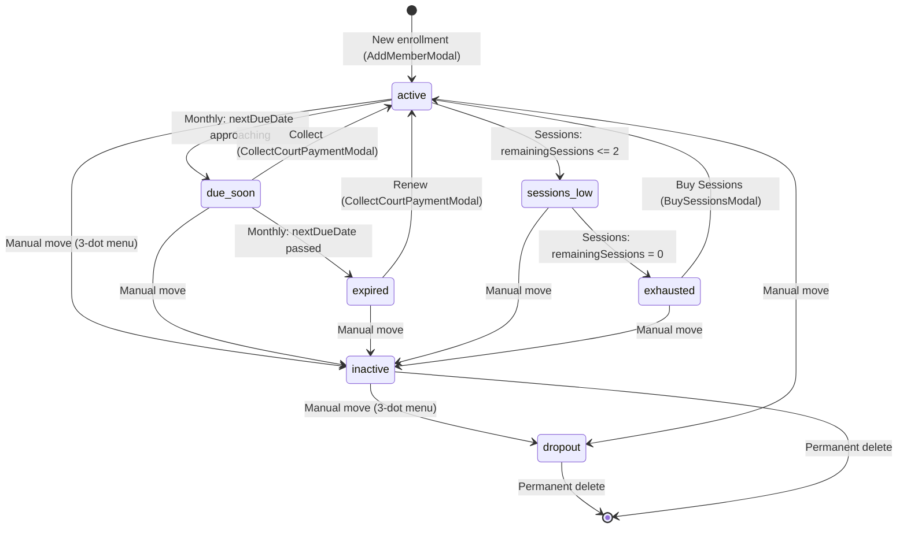
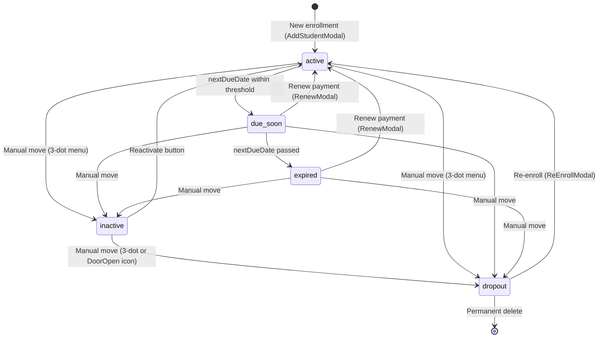

# 🏸 Pro Badminton (EzyFee) — Project Status & Handoff

> **Base Audit:** [Saas.md](file:///d:/DEVELOPMENT/SOFTWARES/SPORTS/Pro%20Badminton/Saas.md) (09 Sep 2026)  
> **Status Update:** 12 Sep 2026  
> **Purpose:** Handoff document for new session continuity  

> [!IMPORTANT]
> The **[Saas.md](file:///d:/DEVELOPMENT/SOFTWARES/SPORTS/Pro%20Badminton/Saas.md)** file remains the canonical full codebase audit. This document only covers **what has changed since** that audit. Read Saas.md first for full context on architecture, tech stack, auth flow, design tokens, typography, utility functions, and business logic foundations.

---

## 1. What Has NOT Changed (Confirmed Stable)

These sections from Saas.md are **still accurate as-is** — no need to re-audit:

- **Tech Stack** (Section 2) — Same Next.js 16, React 19, Tailwind v4, Supabase auth-only, date-fns, lucide-react
- **External Services** — Still Supabase auth + Google Fonts only, no database
- **Architecture** (Section 3) — Same client-heavy CSR, server layout for auth, in-memory mock data
- **Auth Flow** (Section 3.3) — Unchanged
- **Routes & Navigation** (Section 5) — Same route map, same sidebar items, same drill-down patterns
- **Data Storage Model** (Section 6.1) — Still ephemeral `let` arrays in mock-data.ts
- **Design Tokens & Theme** (Section 8) — All `so-` prefixed tokens unchanged
- **Typography** (Section 8.2) — Inter font, same weights
- **Global Styles** (Section 8.3) — Selection, scrollbar, spin buttons unchanged
- **Utility Functions** (Section 12) — `formatCurrency`, `formatDate`, `formatTime`, etc. unchanged
- **Dashboard** (Section 7.2) — No changes
- **Batches** (Sections 7.5, 7.6) — No changes
- **Events** (Section 7.9) — No changes
- **Login** (Section 7.1) — No changes

---

## 2. Changes Since Audit

### 2.1 Student Status Enum Change

**Before (Saas.md):**
```typescript
status: 'active' | 'due-soon' | 'expired' | 'off-court'
```

**Now:**
```typescript
status: 'active' | 'due-soon' | 'expired' | 'inactive' | 'dropout'
```

- `'off-court'` has been **split** into two distinct states:
  - `'inactive'` — Student is on hold (temporarily not attending, may return)
  - `'dropout'` — Student has left the academy (equivalent to the old off-court)

---

### 2.2 New Types Added to mock-data.ts

Three new types were introduced to support the **Court Membership** feature:

#### CourtPlan
| Field | Type | Description |
|---|---|---|
| `id` | `string` | Unique identifier |
| `name` | `string` | Display name |
| `planType` | `'monthly' \| 'sessions'` | Plan category |
| `price` | `number` | Price in INR |
| `durationMonths?` | `number` | Monthly plans: how many months covered |
| `totalSessions?` | `number` | Session plans: sessions in pack |
| `validityDays?` | `number` | Session plans: days before unused sessions expire |

#### CourtPaymentEntry
| Field | Type | Description |
|---|---|---|
| `id` | `string` | Unique identifier |
| `date` | `string` | Payment date (yyyy-MM-dd) |
| `amount` | `number` | Amount paid |
| `paymentMethod` | `'cash' \| 'upi' \| 'card' \| 'other'` | Payment mode |
| `entryType` | `'new' \| 'renewal' \| 'session-topup'` | Payment classification |
| `status` | `'active' \| 'deleted'` | Record status |
| `note?` | `string` | Optional note |

#### CourtMember
| Field | Type | Description |
|---|---|---|
| `id` | `string` | Unique identifier |
| `name` | `string` | Full name |
| `phone` | `string` | Phone number |
| `planId?` | `string` | FK to CourtPlan |
| `durationMonths?` | `number` | Override duration |
| `planType` | `'monthly' \| 'sessions'` | Plan category |
| `joiningDate` | `string` | Enrollment date |
| `membershipStartDate?` | `string` | Monthly: current period start |
| `nextDueDate?` | `string` | Monthly: next payment due |
| `totalSessions?` | `number` | Sessions: total purchased |
| `remainingSessions?` | `number` | Sessions: remaining count |
| `status` | `'active' \| 'due-soon' \| 'expired' \| 'sessions-low' \| 'exhausted' \| 'inactive' \| 'dropout'` | Current status |
| `amountPaid` | `number` | Total amount paid |
| `notes?` | `string` | Optional notes |
| `paymentHistory` | `CourtPaymentEntry[]` | Embedded payment records |
| `checkInHistory` | `Array<{ id, date, sessionsAfter }>` | Session check-in log |

#### Settings Type Updated
```typescript
export type Settings = {
  courtMembershipEnabled: boolean;  // NEW — toggle for court feature
  courtPlans: CourtPlan[];          // NEW — court plan definitions
  courtName: string
  membershipTypes: MembershipType[]
  batches: string[]
}
```

> [!NOTE]
> `AccountEntry` type may have minor changes (expense/income) but is largely the same as documented in Saas.md Section 6.2.

---

### 2.3 New Component Files

#### `src/components/court/` (NEW directory — 4 files)

| Component | File | Size | Purpose |
|---|---|---|---|
| `AddMemberModal` | [AddMemberModal.tsx](file:///d:/DEVELOPMENT/SOFTWARES/SPORTS/Pro%20Badminton/src/components/court/AddMemberModal.tsx) | ~10KB | Add new court member with flexible plan selector (Sessions or Monthly segmented control, +/- counters) |
| `EditCourtMemberModal` | [EditCourtMemberModal.tsx](file:///d:/DEVELOPMENT/SOFTWARES/SPORTS/Pro%20Badminton/src/components/court/EditCourtMemberModal.tsx) | ~6.5KB | Edit court member details (name, phone, joining date, fees, sessions) |
| `CollectCourtPaymentModal` | [CollectCourtPaymentModal.tsx](file:///d:/DEVELOPMENT/SOFTWARES/SPORTS/Pro%20Badminton/src/components/court/CollectCourtPaymentModal.tsx) | ~4.3KB | Collect/renew payment for monthly court members |
| `BuySessionsModal` | [BuySessionsModal.tsx](file:///d:/DEVELOPMENT/SOFTWARES/SPORTS/Pro%20Badminton/src/components/court/BuySessionsModal.tsx) | ~4.7KB | Purchase additional session packs for session-based members |

#### `src/components/accounts/` (NEW directory — 1 file)

| Component | File | Size | Purpose |
|---|---|---|---|
| `EditInventoryModal` | [EditInventoryModal.tsx](file:///d:/DEVELOPMENT/SOFTWARES/SPORTS/Pro%20Badminton/src/components/accounts/EditInventoryModal.tsx) | ~4.3KB | Edit existing inventory product (pencil icon action in inventory table) |

---

### 2.4 Members Page (formerly "Students" in sidebar context)

**File:** [students/page.tsx](file:///d:/DEVELOPMENT/SOFTWARES/SPORTS/Pro%20Badminton/src/app/(management)/students/page.tsx) (~919 lines)

#### What Changed:

**1. Coaching/Court Segment Toggle**
- When `mockSettings.courtMembershipEnabled` is `true`, a segmented control bar appears at the top: **Coaching | Court**
- Default segment: `coaching`
- Switching to `court` renders the full Court Members UI

**2. Tab Renaming (Coaching Segment)**
- **Before:** Active | Off-Court
- **Now:** Active | Inactive | Dropout (3 tabs)
- Internal values: `'active' | 'inactive' | 'dropout'`
- Tab labels display: "Active", "On Hold" (for inactive), "Off-Court" (for dropout)

**3. Active Tab — Action Column Overhaul**
- **Before:** Edit button + Move to Off-Court inline confirm
- **Now:** 3-dot context menu (`MoreVertical` icon) with:
  1. Move to Inactive
  2. Move to Dropout
  3. Delete Permanently (with inline confirmation popup)

**4. Inactive Tab (NEW)**
- Table: Name, Mobile, Batch, Guardian, Actions
- Shows "Inactive" badge on each row
- Actions:
  - **Reactivate** button (sets status back to `'active'`)
  - **Move to Dropout** icon (DoorOpen icon with inline confirm)
  - **3-dot menu** → Move to Inactive (redundant but present)

**5. Dropout Tab (formerly Off-Court)**
- Same as before: Re-enroll trigger + Delete permanently
- Uses `ReEnrollModal` for re-enrollment

**6. Court Members Segment (NEW)**
- KPI cards: Total, Active, Due/Low, Expired/Done
- Tabs: Active | Inactive | Dropout
- Filter pills on Active tab: All | Monthly | Sessions
- Table columns: Member (avatar+name+phone), Plan (name+type badge), Validity (date for monthly / progress bar for sessions), Status (badge), Action
- **Session Check-In flow:** "Check In" button → inline confirm "Log 1 session? (N left)" → Yes/No
- **Undo check-in:** Available on same row after check-in
- 3-dot context menu per tab (same pattern as coaching: Move to Inactive/Dropout/Delete)
- Modals: `AddMemberModal`, `EditCourtMemberModal`

---

### 2.5 Student Detail Page

**File:** [students/[id]/page.tsx](file:///d:/DEVELOPMENT/SOFTWARES/SPORTS/Pro%20Badminton/src/app/(management)/students/[id]/page.tsx) (~558 lines)

- Mostly unchanged from Saas.md audit
- Still has Details | Transactions tabs
- Student status references updated to match new enum (`'inactive'` / `'dropout'` instead of `'off-court'`)

---

### 2.6 Transactions Page

**File:** [transactions/page.tsx](file:///d:/DEVELOPMENT/SOFTWARES/SPORTS/Pro%20Badminton/src/app/(management)/transactions/page.tsx) (~1185 lines)

#### What Changed:

**1. Coaching/Court Segment Toggle**
- Same segmented control as Members page: **Coaching | Court**
- Controlled by `mockSettings.courtMembershipEnabled`

**2. Coaching Segment**
- Unchanged from audit (Recent | Paid | Pending | Partial tabs, bulk collect, void, renew modal)
- Pending/Partial rows now exclude `'inactive'` and `'dropout'` students

**3. Court Segment (NEW)**
- Full transaction management for court members
- Tabs: Recent | Paid | Pending | Partial
- **Recent:** All court member payments in date range (member name, phone, date, amount, method, entry type badge, status badge)
- **Paid:** Only active payments with Void action
- **Pending:** Court members with status `expired`, `due-soon`, or `exhausted`
  - Monthly expired → "Renew" button → `CollectCourtPaymentModal`
  - Monthly due-soon → "Collect" button → `CollectCourtPaymentModal`
  - Sessions exhausted → "Buy Sessions" button → `BuySessionsModal`
- **Partial:** Placeholder ("coming soon")
- Same date range filters as coaching: Current Month, Last Month, Current FY, Last FY, Custom

---

### 2.7 Settings Page

**File:** [settings/page.tsx](file:///d:/DEVELOPMENT/SOFTWARES/SPORTS/Pro%20Badminton/src/app/(management)/settings/page.tsx) (~580 lines)

#### What Changed:

**1. Court Membership Toggle (NEW — Section 0)**
- Toggle switch to enable/disable `mockSettings.courtMembershipEnabled`
- When enabled, shows Court Plans management section

**2. Court Plans CRUD (NEW)**
- Add new court plan form:
  - Name, Plan Type (monthly/sessions), Price
  - If monthly: Duration in months
  - If sessions: Total sessions + Validity days
- List existing court plans with Delete action
- Plans stored in `mockCourtPlans` array

**3. Existing sections unchanged:**
- Section 1: Facility Profile — same
- Section 2: Membership Types — same
- Section 3: Events Management — same

---

### 2.8 Accounts Page (Inventory)

**File:** [accounts/page.tsx](file:///d:/DEVELOPMENT/SOFTWARES/SPORTS/Pro%20Badminton/src/app/(management)/accounts/page.tsx)

#### What Changed:

- **Edit button added** to inventory table Action column (Pencil icon beside Delete)
- Clicking pencil opens `EditInventoryModal` populated with current row data
- Accounts (Expenses/Income) sub-tabs — unchanged

---

### 2.9 Modal Component Changes

#### AddStudentModal
**File:** [AddStudentModal.tsx](file:///d:/DEVELOPMENT/SOFTWARES/SPORTS/Pro%20Badminton/src/components/students/AddStudentModal.tsx) (433 lines)
- No major structural changes; still handles coaching student enrollment
- Same props interface: `{ onClose, onSuccess, defaultBatch? }`

#### EditStudentModal  
**File:** [EditStudentModal.tsx](file:///d:/DEVELOPMENT/SOFTWARES/SPORTS/Pro%20Badminton/src/components/students/EditStudentModal.tsx) (341 lines)
- No major structural changes
- Same props: `{ student, onClose, onSave }`

#### ReEnrollModal
**File:** [ReEnrollModal.tsx](file:///d:/DEVELOPMENT/SOFTWARES/SPORTS/Pro%20Badminton/src/components/students/ReEnrollModal.tsx) (368 lines)
- No major structural changes
- Same props: `{ student, onClose, onConfirm }`
- Used in Dropout tab for re-enrollment

---

## 3. Updated File Structure (Delta Only)

```diff
 src/
   components/
+    accounts/
+      EditInventoryModal.tsx          # [NEW] Edit inventory product modal
+    court/                            # [NEW] Entire directory
+      AddMemberModal.tsx              # [NEW] Add court member (flexible plan selector)
+      BuySessionsModal.tsx            # [NEW] Purchase session packs
+      CollectCourtPaymentModal.tsx    # [NEW] Collect/renew monthly payment
+      EditCourtMemberModal.tsx        # [NEW] Edit court member details
     students/
       AddStudentModal.tsx             # Minor updates
       EditStudentModal.tsx            # Minor updates
       ReEnrollModal.tsx               # Minor updates
   lib/
     mock-data.ts                      # +CourtPlan, +CourtPaymentEntry, +CourtMember types
                                       # +Settings.courtMembershipEnabled
                                       # +mockCourtPlans, +mockCourtMembers arrays
                                       # Student.status updated (inactive/dropout replaces off-court)
   app/(management)/
     students/
       page.tsx                        # Major: +Court segment, +3 tabs, +3-dot menus
       [id]/page.tsx                   # Minor: status enum alignment
     transactions/
       page.tsx                        # Major: +Court segment with full tx management
     settings/
       page.tsx                        # +Court toggle, +Court Plans CRUD
     accounts/
       page.tsx                        # +Edit button in inventory table
```

---

## 4. Updated Component Registry

### 4.1 Modal Components (Complete List)

| Component | File | Size | Trigger Context |
|---|---|---|---|
| `AddStudentModal` | [AddStudentModal.tsx](file:///d:/DEVELOPMENT/SOFTWARES/SPORTS/Pro%20Badminton/src/components/students/AddStudentModal.tsx) | 433 lines | Members page (coaching), Batch detail |
| `EditStudentModal` | [EditStudentModal.tsx](file:///d:/DEVELOPMENT/SOFTWARES/SPORTS/Pro%20Badminton/src/components/students/EditStudentModal.tsx) | 341 lines | Members page (coaching), Batch detail |
| `ReEnrollModal` | [ReEnrollModal.tsx](file:///d:/DEVELOPMENT/SOFTWARES/SPORTS/Pro%20Badminton/src/components/students/ReEnrollModal.tsx) | 368 lines | Members page (dropout tab) |
| `RenewModal` | [RenewModal.tsx](file:///d:/DEVELOPMENT/SOFTWARES/SPORTS/Pro%20Badminton/src/components/coaching/RenewModal.tsx) | 373 lines | Transactions, Student detail, Batch detail |
| `AddMemberModal` | [AddMemberModal.tsx](file:///d:/DEVELOPMENT/SOFTWARES/SPORTS/Pro%20Badminton/src/components/court/AddMemberModal.tsx) | ~10KB | Members page (court segment) |
| `EditCourtMemberModal` | [EditCourtMemberModal.tsx](file:///d:/DEVELOPMENT/SOFTWARES/SPORTS/Pro%20Badminton/src/components/court/EditCourtMemberModal.tsx) | ~6.5KB | Members page (court segment) |
| `CollectCourtPaymentModal` | [CollectCourtPaymentModal.tsx](file:///d:/DEVELOPMENT/SOFTWARES/SPORTS/Pro%20Badminton/src/components/court/CollectCourtPaymentModal.tsx) | ~4.3KB | Transactions page (court pending tab) |
| `BuySessionsModal` | [BuySessionsModal.tsx](file:///d:/DEVELOPMENT/SOFTWARES/SPORTS/Pro%20Badminton/src/components/court/BuySessionsModal.tsx) | ~4.7KB | Transactions page (court pending tab) |
| `EditInventoryModal` | [EditInventoryModal.tsx](file:///d:/DEVELOPMENT/SOFTWARES/SPORTS/Pro%20Badminton/src/components/accounts/EditInventoryModal.tsx) | ~4.3KB | Accounts page (inventory tab) |

---

## 5. Court Member Lifecycle (NEW)



---

## 6. Updated Student Lifecycle



---

## 7. Remaining Work / Known Pending Items

### From Original Audit (Still Pending)
1. Database schema design + Supabase migration
2. Server Actions for all CRUD operations
3. State management solution (Context or Zustand)
4. Mobile-responsive layout
5. Pagination for lists
6. Export/reporting features
7. User roles and permissions
8. Form validation library integration

### From Recent Feature Spec (Partially Done / Pending Verification)
1. ✅ Court Member Enrollment Modal with flexible plan selector (Sessions/Monthly segmented control with +/- counters)
2. ✅ Edit action for Inventory (pencil icon + EditInventoryModal)
3. ✅ Coaching Students tab renaming (Inactive, Dropout)
4. ✅ Active tab 3-dot context menu (Move to Inactive/Dropout/Delete Permanently)
5. ✅ Inactive tab with Edit + 3-dot menu
6. ✅ Dropout tab with Re-enrollment modal
7. ✅ Court Members module (Active/Inactive/Dropout tabs, context menus)
8. ⬜ Pending Tab Cleanup business logic (auto-cleanup of non-returning students at month-end)
9. ⬜ Edit action for Accounts (Expense & Income entries) — not yet added

---
