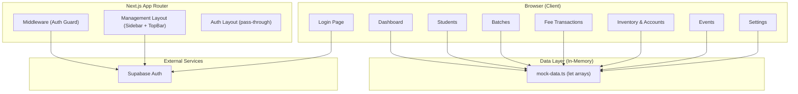
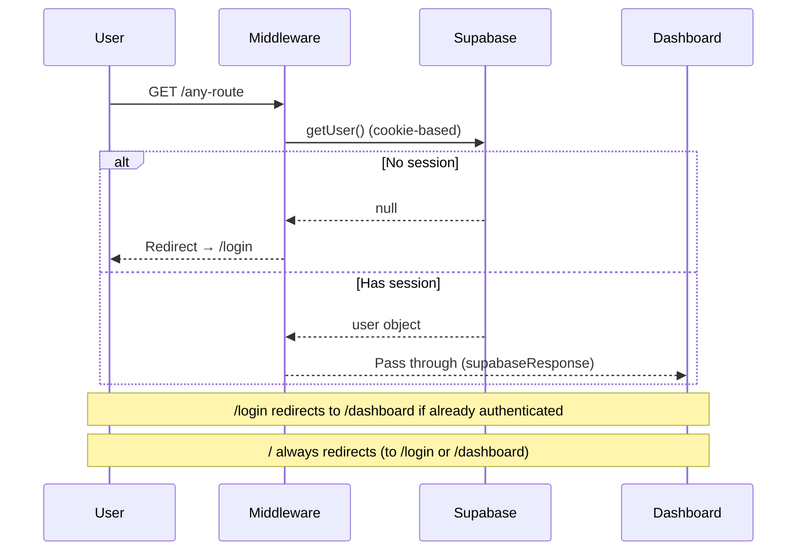
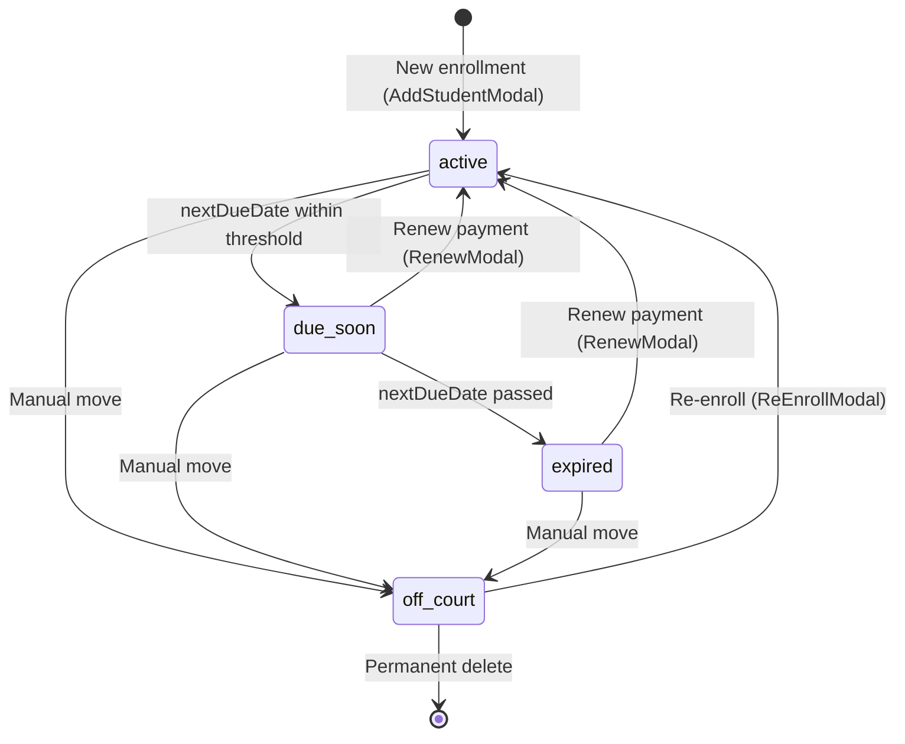

# 🏸 Pro Badminton (EzyFee) — Complete Codebase Audit

> **Audit Date:** 09 Sep 2026  
> **Auditor:** Antigravity AI  
> **Codebase Version:** 0.1.0  
> **Project Name in `package.json`:** `"pro badminton"`  
> **Brand Name in UI:** `EzyFee`

---

## 1. Project Overview

EzyFee is a **fee management and academy administration system** designed for **badminton coaching academies** in India. It provides an internal staff portal to manage students, memberships, batches, attendance, fee transactions, inventory, expenses/income, and events.

The application is **single-tenant** (one academy per deployment) and **staff-only** (no student-facing UI). Authentication is email/password via Supabase, but **all data is stored in-memory mock arrays** — Supabase is used exclusively for auth, not as a database.

---

## 2. Tech Stack

| Layer | Technology | Version |
|---|---|---|
| **Framework** | Next.js (App Router) | 16.3.1 |
| **Language** | TypeScript | ^5 |
| **UI Library** | React | 19.2.8 |
| **Styling** | Tailwind CSS v4 + `@tailwindcss/postcss` | ^4 |
| **Auth Backend** | Supabase (Auth only) | `@supabase/ssr` ^0.12.4, `@supabase/supabase-js` ^2.112.3 |
| **Date Utilities** | date-fns | ^4.4.0 |
| **Icons** | lucide-react | ^1.34.0 |
| **Linting** | ESLint 9 + eslint-config-next | ^9 |
| **Font** | Inter (Google Fonts, loaded via CSS `@import`) | 400–700 |
| **Module Resolution** | `@/*` → `./src/*` (path alias) | — |

### External Services

| Service | Purpose | Notes |
|---|---|---|
| **Supabase** | Authentication only (email/password sign-in) | Project: `flyvqsuovlamnybuvxgq.supabase.co` |
| **Google Fonts CDN** | Loads `Inter` typeface | Runtime CSS import |

> [!IMPORTANT]
> No database, API, or remote data storage is used. **All business data lives in JavaScript module-level `let` variables** (in-memory mock arrays). Data is lost on every page refresh or server restart.

---

## 3. Architecture

### 3.1 High-Level Architecture



### 3.2 Rendering Strategy

| Page | Rendering | Notes |
|---|---|---|
| Login | `'use client'` (CSR) | Client-side Supabase auth call |
| Management Layout | **Server Component** (async) | Calls `supabase.auth.getUser()` server-side |
| Dashboard | `'use client'` (CSR) | Reads mock data client-side |
| Students (list) | `'use client'` (CSR) | Reads + mutates mock data |
| Student `[id]` detail | `'use client'` (CSR) | Reads + mutates mock data |
| Batches (list) | `'use client'` (CSR) | Reads + mutates mock data |
| Batch `[id]` detail | `'use client'` (CSR) | Reads + mutates mock data |
| Transactions | `'use client'` (CSR) | Reads + mutates mock data |
| Accounts | `'use client'` (CSR) | Reads + mutates mock data |
| Events | `'use client'` (CSR) | Read-only from mock data |
| Settings | `'use client'` (CSR) | Reads + mutates mock data |

> [!NOTE]
> **Every route page except the root page is a client component.** The management layout is the only server component that does meaningful work (auth check). This is an extremely client-heavy architecture with no SSR data fetching.

### 3.3 Auth Flow



---

## 4. File Structure

```
Pro Badminton/
├── .env.local                          # Supabase URL + anon key
├── package.json
├── tsconfig.json
├── next.config.ts                      # ⚠ BUG: dual export
├── postcss.config.mjs
├── eslint.config.mjs
├── pro_logo.png                        # Brand logo (root, not in /public) ⚠
├── public/
│   ├── file.svg, globe.svg, next.svg   # Default Next.js starter assets (unused)
│   ├── vercel.svg, window.svg
│   └── (no pro_logo.png here)
├── src/
│   ├── middleware.ts                   # Auth guard middleware
│   ├── app/
│   │   ├── globals.css                 # Design tokens + base styles
│   │   ├── layout.tsx                  # Root layout (metadata: "EzyFee")
│   │   ├── page.tsx                    # Root page (default Next.js boilerplate) ⚠
│   │   ├── (auth)/
│   │   │   └── login/
│   │   │       ├── layout.tsx          # Pass-through fragment
│   │   │       └── page.tsx            # Login form (client)
│   │   └── (management)/
│   │       ├── layout.tsx              # Sidebar + TopBar + auth check (server)
│   │       ├── dashboard/
│   │       │   ├── page.tsx            # Dashboard stats + batch revenue
│   │       │   ├── loading.tsx         # Skeleton loader
│   │       │   └── error.tsx           # Error boundary
│   │       ├── students/
│   │       │   ├── page.tsx            # Student list (active/off-court tabs)
│   │       │   ├── loading.tsx
│   │       │   ├── error.tsx
│   │       │   └── [id]/
│   │       │       └── page.tsx        # Student profile + transactions
│   │       ├── batches/
│   │       │   ├── page.tsx            # Batch list + CRUD
│   │       │   ├── loading.tsx
│   │       │   └── [id]/
│   │       │       ├── page.tsx        # Batch detail (attendance/students/tx)
│   │       │       └── loading.tsx
│   │       ├── transactions/
│   │       │   ├── page.tsx            # Fee transaction ledger
│   │       │   ├── loading.tsx
│   │       │   └── error.tsx
│   │       ├── accounts/
│   │       │   ├── page.tsx            # Inventory + Expenses + Income (1118 lines)
│   │       │   └── loading.tsx
│   │       ├── events/
│   │       │   ├── page.tsx            # Upcoming events (read-only display)
│   │       │   ├── loading.tsx
│   │       │   └── error.tsx
│   │       └── settings/
│   │           ├── page.tsx            # Facility, membership types, event CRUD
│   │           ├── loading.tsx
│   │           └── error.tsx
│   ├── components/
│   │   ├── .gitkeep
│   │   ├── coaching/
│   │   │   └── RenewModal.tsx          # Renew/Collect-remaining payment modal
│   │   ├── layout/
│   │   │   ├── Sidebar.tsx             # Navigation sidebar + sign-out
│   │   │   ├── TopBar.tsx              # Top bar (clock only)
│   │   │   └── LiveClock.tsx           # Real-time IST clock
│   │   ├── students/
│   │   │   ├── AddStudentModal.tsx     # Add new student modal
│   │   │   ├── EditStudentModal.tsx    # Edit student details modal
│   │   │   └── ReEnrollModal.tsx       # Re-enroll off-court student modal
│   │   └── ui/
│   │       ├── StatusBadge.tsx         # Status badge (Available/Booked/Blocked)
│   │       └── ConfirmDialog.tsx       # ⚠ STUB: renders empty <div>
│   └── lib/
│       ├── mock-data.ts               # ALL type definitions + seed data (430 lines)
│       ├── utils.ts                    # Formatting helpers (currency, date, time)
│       └── supabase/
│           ├── client.ts              # Browser Supabase client
│           └── server.ts              # Server Supabase client (cookies)
```

---

## 5. Routing & Navigation

### 5.1 Route Map

| Route | Page | Route Group | Access |
|---|---|---|---|
| `/` | Default Next.js boilerplate | — | Redirects via middleware |
| `/login` | Login form | `(auth)` | Public (redirects if authenticated) |
| `/dashboard` | Dashboard | `(management)` | Authenticated |
| `/students` | Student list | `(management)` | Authenticated |
| `/students/[id]` | Student profile | `(management)` | Authenticated |
| `/batches` | Batch list | `(management)` | Authenticated |
| `/batches/[id]` | Batch detail (attendance, students, tx) | `(management)` | Authenticated |
| `/transactions` | Fee transactions | `(management)` | Authenticated |
| `/accounts` | Inventory & accounts | `(management)` | Authenticated |
| `/events` | Upcoming events | `(management)` | Authenticated |
| `/settings` | Settings | `(management)` | Authenticated |

### 5.2 Sidebar Navigation Items

| Order | Label | Href | Icon |
|---|---|---|---|
| 1 | Dashboard | `/dashboard` | `LayoutDashboard` |
| 2 | Students | `/students` | `Users` |
| 3 | Batches | `/batches` | `LayoutGrid` |
| 4 | Fee Transactions | `/transactions` | `Receipt` |
| 5 | Upcoming Events | `/events` | `CalendarDays` |
| 6 | Inventory & Accounts | `/accounts` | `BookOpen` |
| — | *(divider)* | — | — |
| 7 | Settings | `/settings` | `Settings` |

### 5.3 Navigation Patterns

- **Primary:** Sidebar links (always visible)
- **Drill-down:** Student name click → `/students/[id]`; Batch card click → `/batches/[id]`
- **Back navigation:** `ArrowLeft` button on detail pages using `router.push('/students')` or `router.back()`
- **Post-auth:** Login → `router.push('/dashboard')` + `router.refresh()`

---

## 6. Data Layer

### 6.1 Data Storage Model

> [!CAUTION]
> **All data is ephemeral.** The application uses mutable `let` arrays at module scope in [mock-data.ts](file:///d:/DEVELOPMENT/SOFTWARES/SPORTS/Pro%20Badminton/src/lib/mock-data.ts). Any page navigation that causes a module re-evaluation, any hot-reload, or any browser refresh resets all data to seed values. This is fundamentally incompatible with a production application.

### 6.2 Type Definitions

#### Student
| Field | Type | Description |
|---|---|---|
| `id` | `string` | Unique identifier |
| `name` | `string` | Full name |
| `phone` | `string` | Primary phone |
| `alternatePhone` | `string` | Secondary phone |
| `guardianName` | `string` | Parent/guardian name |
| `membershipTypeId` | `string` | FK to MembershipType |
| `currentBatch` | `string` | Batch **name** (not ID) ⚠ |
| `fees` | `number` | Per-period fee (may differ from membership price) |
| `startDate` | `string` | Original enrollment date |
| `membershipStartDate` | `string` | Current membership period start |
| `nextDueDate` | `string` | Next payment due date |
| `status` | `'active' \| 'due-soon' \| 'expired' \| 'off-court'` | Current status |
| `pendingAmount` | `number` | Outstanding partial payment |
| `internalNotes` | `string` | Staff notes |
| `paymentHistory` | `PaymentEntry[]` | Embedded payment records |

#### PaymentEntry
| Field | Type | Description |
|---|---|---|
| `id` | `string` | Unique identifier |
| `date` | `string` | Payment date (yyyy-MM-dd) |
| `amount` | `number` | Amount paid |
| `remainingAmount` | `number` | Unpaid balance for this period |
| `paymentType` | `'full' \| 'partial' \| 'advance'` | Payment classification |
| `monthsCovered` | `number` | Number of periods covered |
| `paymentMethod` | `'cash' \| 'upi' \| 'card' \| 'other'` | Payment mode |
| `status` | `'active' \| 'inactive' \| 'deleted'` | Record status |
| `note` | `string` | Optional note |

#### MembershipType
| Field | Type | Description |
|---|---|---|
| `id` | `string` | Unique identifier |
| `name` | `string` | Display name (e.g., "Monthly") |
| `durationType` | `'months' \| 'days'` | Duration unit |
| `duration` | `number` | Duration value |
| `price` | `number` | Base price in INR |

#### Batch
| Field | Type | Description |
|---|---|---|
| `id` | `string` | Unique identifier |
| `name` | `string` | Display name |
| `days` | `string[]` | Active days of week |
| `fees?` | `number` | Optional batch-level fee override |
| `description?` | `string` | e.g., "6:00 AM – 8:00 AM" |

#### AttendanceRecord
| Field | Type | Description |
|---|---|---|
| `id` | `string` | Compound key (`batchId-date`) |
| `batchId` | `string` | FK to Batch |
| `date` | `string` | yyyy-MM-dd |
| `records` | `Record<string, 'present' \| 'absent'>` | studentId → status map |

#### AccountEntry (Expenses & Income)
| Field | Type | Description |
|---|---|---|
| `id` | `string` | Unique identifier |
| `date` | `string` | Entry date |
| `category` | `string` | Category name |
| `description` | `string` | Entry description |
| `amount` | `number` | Always positive |
| `notes?` | `string` | Optional notes |
| `itemName?` | `string` | Income only — inventory item |

#### InventoryItem
| Field | Type | Description |
|---|---|---|
| `id` | `string` | Unique identifier |
| `name` | `string` | Item name |
| `category` | `string` | Category name |
| `description` | `string` | Item description |
| `quantity` | `number` | Stock count |
| `price` | `number` | Unit price in INR |

### 6.3 Seed Data

| Entity | Count | Notes |
|---|---|---|
| Students | 12 | Mix of active, due-soon, expired, off-court |
| Batches | 2 | Morning (6 days), Evening (4 days) |
| Membership Types | 3 | Monthly (₹1,500), Quarterly (₹4,000), Annual (₹14,000) |
| Events | 3 | 1 past (auto-hidden), 2 future |
| Expenses | 6 | Relative dates (subDays) |
| Income | 4 | Relative dates (subDays) |
| Inventory Items | 6 | Across 4 categories |
| Attendance | Auto-seeded | 7 days × 2 batches, 85% random presence |

### 6.4 Constants

- **Expense Categories (9):** Shuttlecocks, Equipment & Gear, Court Rent, Coaching Staff, Utilities, Maintenance & Repairs, Marketing, Tournament Expenses, Miscellaneous
- **Income Categories (6):** Equipment Sales, Shuttle Sales, Racket Restringing, Merchandise, Rental Income, Other
- **Inventory Categories (4):** Racquet Sports, Footwear, Apparel, Accessories / Miscellaneous
- **Custom categories:** User-created categories stored in mutable `let` arrays (also ephemeral)

---

## 7. Features — Page by Page

### 7.1 Login (`/login`)

- Email/password form with Supabase `signInWithPassword`
- Generic error message "Invalid email or password"
- Loading spinner during auth
- Redirects to `/dashboard` on success
- No sign-up, no password reset, no social login

### 7.2 Dashboard (`/dashboard`)

**KPI Cards:**
1. **Collected** — Total payments in selected date range (filters: This Month, Last Month, Custom)
2. **Due — Current** — Total pending dues across all active students (not date-filtered)
3. **Active Batches** — Count from `mockSettings.batches`
4. **Total Students** — Active + due-soon + expired (excludes off-court); shows off-court count as footnote

**Batch Revenue Section:**
- Per-batch breakdown: expected vs collected vs remaining
- Progress bar with color coding (≥80% green, ≥50% yellow, <50% red)

**Payment Modes:**
- Segmented bar + grid showing Cash/UPI/Card/Other distribution by percentage and amount

### 7.3 Students (`/students`)

**Tabs:** Active | Off-Court

**Active Tab:**
- Search by name or phone
- Batch filter pills (All / per batch)
- Table: Name, Mobile, Batch, Guardian, Total Due, Actions
- Status indicators: (Due Soon) yellow, (Overdue) red
- Actions: Edit (modal), Move to Off-Court (inline confirm)
- Click name → drill-down to student profile

**Off-Court Tab:**
- Table: Name, Mobile, Guardian, Last Batch, Total Due, Actions
- Actions: Re-enroll (modal), Delete permanently (inline confirm with dues warning)

### 7.4 Student Profile (`/students/[id]`)

**Tabs:** Details | Transactions

**Details Tab:**
- Personal info card: Name, Phone, Alternate Phone, Guardian, Batch, Membership Type, Status
- Membership info: Start Date, Membership Start, Next Due, Fees, Pending Amount
- Internal notes

**Transactions Tab (per-student):**
- Sub-tabs: Recent | Paid | Pending | Partial
- Date range filter (This Month, Last Month, Custom)
- Actions: Renew (modal), Collect Remaining, Void (delete)

### 7.5 Batches (`/batches`)

- Card grid: Each batch shows name, schedule days, description, student count, fee
- CRUD: Create batch (inline form), Edit batch (inline form), Delete batch (with protection if students assigned)
- Click card → drill-down to batch detail

### 7.6 Batch Detail (`/batches/[id]`)

**Tabs:** Attendance | Students | Transactions

**Attendance Tab:**
- Two modes: **Insights** (grid view) and **Marking** (per-date marking)
- Insights: Filter by last 5/10/30 days or this month; shows attendance grid per student + batch average
- Marking: Select a date, mark each student present/absent, save
- Color coding: present=green, absent=red, unmarked=gray

**Students Tab:**
- List of students in this batch with status, fees, pending amount
- Actions: Add Student (modal, pre-selects batch), Edit, Move to Off-Court, Renew

**Transactions Tab:**
- Batch-scoped transaction list similar to global transactions page

### 7.7 Fee Transactions (`/transactions`)

**Tabs:** Recent | Paid | Pending | Partial

- **Recent:** All payments in date range (all types)
- **Paid:** Only full/advance payments in date range
- **Pending:** Students with status `expired` or `due-soon` (not date-filtered)
- **Partial:** Students with `pendingAmount > 0` (not date-filtered)

**Features:**
- Search by name or phone
- Date filters: Current Month, Last Month, Current FY, Last FY, Custom
- Bulk Collect: Select multiple pending students → pay all at once with chosen method
- Void transactions: Soft-delete (sets `status = 'deleted'`)
- Renew modal: Pay for N periods, partial payments, batch change

### 7.8 Inventory & Accounts (`/accounts`)

**Segments:** Inventory | Accounts

**Inventory:**
- Product table: Name, Category, Description, Stock, Unit Price
- Filter by category, Sort (name/price/stock asc/desc)
- Add product form with custom category creation
- Delete products

**Accounts (sub-tabs: Expenses | Income):**
- Summary cards: Total Expenses, Total Income, Net Balance
- Date range filter: Current Month, Last Month, Custom
- Expenses: Add/delete expense entries with categories
- Income: Add/delete income entries linked to inventory categories
- Custom expense category creation

### 7.9 Events (`/events`)

- Read-only display of upcoming events (filters out past events)
- Card grid: Type badge, Days-left chip (Today/Tomorrow/N days), Name, Description, Date
- No CRUD on this page (managed in Settings)

### 7.10 Settings (`/settings`)

**Section 1: Facility Profile**
- Edit court/academy name

**Section 2: Membership Types**
- List with edit/delete inline
- Add new type with name, duration, unit, price
- Deletion protected if students are on the plan

**Section 3: Events Management**
- Add new event form (name, type, date, description)
- Tabs: Upcoming | Past
- Delete events (inline confirm)

---

## 8. Design Tokens & Theme

### 8.1 Color System (defined in [globals.css](file:///d:/DEVELOPMENT/SOFTWARES/SPORTS/Pro%20Badminton/src/app/globals.css) `@theme`)

All tokens use the `so-` prefix (likely standing for "Shuttle Operations" or similar).

| Token | Value | Purpose |
|---|---|---|
| `--color-so-bg` | `#F4F6FA` | Page background |
| `--color-so-card` | `#FFFFFF` | Card backgrounds |
| `--color-so-surface` | `#EEF1F8` | Elevated surfaces, table headers |
| `--color-so-border` | `#DDE3EE` | Primary borders |
| `--color-so-border-subtle` | `#EEF1F8` | Subtle borders |
| `--color-so-text` | `#0F1729` | Primary text |
| `--color-so-muted` | `#64748B` | Secondary/muted text |
| `--color-so-grey` | `#484F58` | Grey text |
| `--color-so-accent` | `#3B6BE8` | Primary action blue |
| `--color-so-accent-hover` | `#2563EB` | Accent hover state |
| `--color-so-accent-subtle` | `rgba(59,107,232,0.08)` | Light accent bg |
| `--color-so-accent-muted` | `rgba(59,107,232,0.15)` | Medium accent bg |
| `--color-so-accent-text` | `#FFFFFF` | Text on accent |
| `--color-so-emerald` | `#059669` | Success green |
| `--color-so-emerald-subtle` | `rgba(5,150,105,0.10)` | Success bg |
| `--color-so-red` | `#DC2626` | Error/danger red |
| `--color-so-red-subtle` | `rgba(220,38,38,0.10)` | Error bg |
| `--color-so-yellow` | `#D97706` | Warning yellow |
| `--color-so-yellow-subtle` | `rgba(217,119,6,0.10)` | Warning bg |
| `--color-so-nav` | `#232E44` | Sidebar bg |
| `--color-so-nav-text` | `#FFFFFF` | Sidebar text |
| `--color-so-blue` | `#58A6FF` | Categorical badge |
| `--color-so-purple` | `#BC8CFF` | Categorical badge |
| `--color-so-orange` | `#FFA657` | Categorical badge |

### 8.2 Typography

- **Font:** `Inter` (400, 500, 600, 700) via Google Fonts CDN
- **Fallback:** `system-ui, sans-serif`
- **Global settings:** `-webkit-font-smoothing: antialiased`

### 8.3 Other Global Styles

- **Selection:** Blue tint (`rgba(59,107,232,0.20)`)
- **Scrollbar:** 5px width, white track, `#DDE3EE` thumb, accent blue on hover (WebKit only)
- **Number inputs:** Spin button removal

---

## 9. Component Patterns

### 9.1 Layout Components

| Component | File | Type | Purpose |
|---|---|---|---|
| `Sidebar` | [Sidebar.tsx](file:///d:/DEVELOPMENT/SOFTWARES/SPORTS/Pro%20Badminton/src/components/layout/Sidebar.tsx) | Client | Navigation + user info + sign out |
| `TopBar` | [TopBar.tsx](file:///d:/DEVELOPMENT/SOFTWARES/SPORTS/Pro%20Badminton/src/components/layout/TopBar.tsx) | Client | Wrapper for LiveClock |
| `LiveClock` | [LiveClock.tsx](file:///d:/DEVELOPMENT/SOFTWARES/SPORTS/Pro%20Badminton/src/components/layout/LiveClock.tsx) | Client | Real-time IST clock (1s interval) |

### 9.2 Modal Components

| Component | File | Size | Trigger Context |
|---|---|---|---|
| `AddStudentModal` | [AddStudentModal.tsx](file:///d:/DEVELOPMENT/SOFTWARES/SPORTS/Pro%20Badminton/src/components/students/AddStudentModal.tsx) | 433 lines | Students list, Batch detail |
| `EditStudentModal` | [EditStudentModal.tsx](file:///d:/DEVELOPMENT/SOFTWARES/SPORTS/Pro%20Badminton/src/components/students/EditStudentModal.tsx) | 341 lines | Students list, Batch detail |
| `ReEnrollModal` | [ReEnrollModal.tsx](file:///d:/DEVELOPMENT/SOFTWARES/SPORTS/Pro%20Badminton/src/components/students/ReEnrollModal.tsx) | 368 lines | Students list (Off-court tab) |
| `RenewModal` | [RenewModal.tsx](file:///d:/DEVELOPMENT/SOFTWARES/SPORTS/Pro%20Badminton/src/components/coaching/RenewModal.tsx) | 373 lines | Transactions, Student detail, Batch detail |

### 9.3 UI Primitives

| Component | File | Status |
|---|---|---|
| `StatusBadge` | [StatusBadge.tsx](file:///d:/DEVELOPMENT/SOFTWARES/SPORTS/Pro%20Badminton/src/components/ui/StatusBadge.tsx) | Implemented (Available/Booked/Blocked) |
| `ConfirmDialog` | [ConfirmDialog.tsx](file:///d:/DEVELOPMENT/SOFTWARES/SPORTS/Pro%20Badminton/src/components/ui/ConfirmDialog.tsx) | **STUB — renders empty `<div/>`** |

### 9.4 Common UI Patterns

- **Force-refresh pattern:** `const [, forceUpdate] = useState(0); const refresh = () => forceUpdate(n => n + 1)` — used on every page that mutates mock data
- **Inline confirmation:** Delete/move actions use `confirmId` state to show Yes/No inline instead of a dialog
- **Toast pattern:** Component-level `useState` + `setTimeout(3000)` for success/error toasts (no global toast system)
- **Tab pattern:** String union type + conditional rendering, no abstracted Tab component
- **Modal pattern:** Boolean `show*` state for visibility, `onClose` + `onSuccess`/`onConfirm` callbacks
- **Date filtering:** `computeRange()` helper returning `{start, end}` + `isWithinInterval()` from date-fns

---

## 10. Business Logic

### 10.1 Student Lifecycle



### 10.2 Fee Calculation

1. **Base fee** = `membershipType.price`
2. **Discounts** (at enrollment/re-enrollment only): Flat ₹ or %, applied to base
3. **Partial payments:** `amountPaying < totalAmount` → `remainingAmount = totalAmount - amountPaying`, `pendingAmount` set on student
4. **Multi-period renewal:** `totalAmount = price × periods`, new due date computed by chaining `addMonths` or `addDays`
5. **Batch-level fee override:** `Batch.fees` exists but is **not used** in any fee calculation

### 10.3 Status Determination

The status field is **manually set** during operations, not automatically computed:
- `AddStudentModal` sets `status = 'active'`
- `RenewModal` sets `status = 'active'`
- `ReEnrollModal` sets `status = 'active'`
- Move to Off-Court sets `status = 'off-court'`
- **No automatic transition** from `active` → `due-soon` or `due-soon` → `expired` based on dates

### 10.4 Attendance Logic

- Attendance is per-batch, per-date
- Only non-off-court students in the batch are eligible
- Save creates/updates an `AttendanceRecord` in `mockAttendance`
- Insights compute per-student attendance percentage over selected date range
- Batch average is computed across all students and recorded dates

### 10.5 Financial Overview (Accounts)

- **Expenses** and **Income** are separate arrays with their own categories
- **Net Balance** = Total Income − Total Expenses (within date range)
- Fee income from students is **NOT** included in the accounts income
- Inventory is tracked separately and not linked to expense/income transactions

---

## 12. Utility Functions ([utils.ts](file:///d:/DEVELOPMENT/SOFTWARES/SPORTS/Pro%20Badminton/src/lib/utils.ts))

| Function | Purpose | Notes |
|---|---|---|
| `formatCurrency(amount)` | Format as INR (`₹1,500`) | Uses `Intl.NumberFormat('en-IN')`, no decimals |
| `formatDate(date)` | Format as `DD/MM/YYYY` | IST timezone, accepts Date or string |
| `formatTime(time)` | Format `HH:MM` → `6:00 AM` | Manual AM/PM conversion |
| `formatSlot(start, end)` | Format time range | Concatenates two `formatTime` calls |
| `getTodayIST()` | Today as `YYYY-MM-DD` in IST | Uses `en-CA` locale trick for ISO format |
| `getDateDaysAgoIST(n)` | Date N days ago as `YYYY-MM-DD` | IST-aware |
| `getFirstDayOfMonthIST()` | First day of current month | IST-aware |

> [!NOTE]
> `formatSlot` uses `→` character but the JSDoc comment shows `→`. The `formatTime` function works for simple cases but doesn't handle edge cases like `24:00` or invalid input.

---

## 13. Summary of Findings

### What's Working Well ✅
- Clean, consistent design language with well-organized design tokens
- Good use of Tailwind CSS v4 `@theme` for custom properties
- Proper Supabase auth flow with middleware, server-side checks, and cookie handling
- Loading skeletons and error boundaries on most routes
- Comprehensive business model covering the full academy workflow
- Nice inline confirmation UX pattern for destructive actions
- Date-range filtering is well-implemented across multiple pages


### What Should Be Planned 📋
1. Database schema design + Supabase migration
2. Server Actions for all CRUD operations
3. State management solution (Context or Zustand)
4. Mobile-responsive layout
5. Pagination for lists
6. Export/reporting features
7. User roles and permissions
8. Form validation library integration
