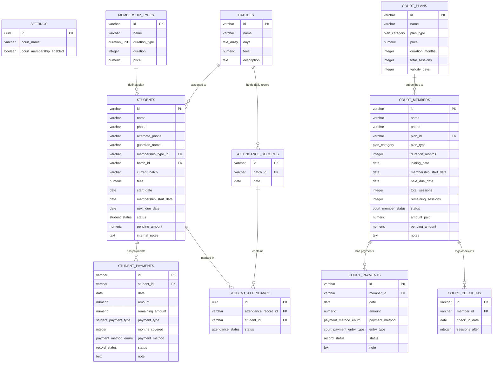

# 🏸 Pro Badminton (EzyFee) — Complete Data Layer & Database Schema

> **Document Version:** 1.0.0  
> **Updated Date:** 18 Sep 2026  
> **Source Documents:** [Saas.md](file:///d:/DEVELOPMENT/SOFTWARES/SPORTS/Pro%20Badminton/Saas.md) & [Project_Status.md](file:///d:/DEVELOPMENT/SOFTWARES/SPORTS/Pro%20Badminton/Project_Status.md) & [`mock-data.ts`](file:///d:/DEVELOPMENT/SOFTWARES/SPORTS/Pro%20Badminton/src/lib/mock-data.ts)  
> **Database Script:** [`database_schema.sql`](file:///d:/DEVELOPMENT/SOFTWARES/SPORTS/Pro%20Badminton/database_schema.sql)  

---

## 🛑 EXCLUSION SUMMARY

As per explicit requirements, the following entities and modules have been **COMPLETELY EXCLUDED** from the data layer and schema definition:
1. ❌ **Upcoming Events** (`Event`, `mockEvents`, events table)
2. ❌ **Inventory** (`InventoryItem`, `mockInventoryItems`, categories, product inventory table)
3. ❌ **Accounts & Expenses/Income** (`AccountEntry`, `mockExpenses`, `mockIncomeEntries`, expense/income tables)

---

## 1. Core Architecture & Entity Overview

The schema is divided into three core operational domains:
1. **Facility Configuration & System Settings** (`settings`, `membership_types`, `batches`)
2. **Coaching Academy Core** (`students`, `student_payments`, `attendance_records`, `student_attendance`)
3. **Court Membership Module** (`court_plans`, `court_members`, `court_payments`, `court_check_ins`)



---

## 2. PostgreSQL Enumerated Types (Enums)

### 2.1 `student_status`
- `'active'`: Student is actively attending and up-to-date with fee payments.
- `'due-soon'`: Payment due date is within the alert threshold.
- `'expired'`: Payment due date has passed without full settlement.
- `'inactive'`: Student is temporarily on hold / paused.
- `'dropout'`: Student has left the academy (formerly off-court).

### 2.2 `court_member_status`
- `'active'`: Active court subscription.
- `'due-soon'`: Monthly plan due date approaching.
- `'expired'`: Monthly plan expired.
- `'sessions-low'`: Session plan has 2 or fewer remaining sessions.
- `'exhausted'`: Session pack reached 0 sessions.
- `'inactive'`: Member temporarily paused.
- `'dropout'`: Member quit court membership.

### 2.3 `duration_unit`
- `'months'` / `'days'`

### 2.4 `plan_category`
- `'monthly'` / `'sessions'`

### 2.5 `payment_method_enum`
- `'cash'`, `'upi'`, `'card'`, `'other'`

### 2.6 `student_payment_type`
- `'full'`, `'partial'`, `'advance'`

### 2.7 `court_payment_entry_type`
- `'new'`, `'renewal'`, `'session-topup'`

### 2.8 `record_status`
- `'active'`, `'inactive'`, `'deleted'`

### 2.9 `attendance_status`
- `'present'`, `'absent'`

---

## 3. Detailed Table & Field Specifications

### 3.1 `settings` (Facility & Feature Flags)
| Column Name | Database Type | Constraints | Description | TypeScript Property |
|---|---|---|---|---|
| `id` | `UUID` | Primary Key, `gen_random_uuid()` | Unique settings record | `id: string` |
| `court_name` | `VARCHAR(255)` | NOT NULL, DEFAULT `'EzyFee'` | Brand / Academy Name | `courtName: string` |
| `court_membership_enabled` | `BOOLEAN` | NOT NULL, DEFAULT `false` | Master toggle for Court feature | `courtMembershipEnabled: boolean` |
| `created_at` | `TIMESTAMPTZ` | DEFAULT `NOW()` | Record creation timestamp | `createdAt?: Date` |
| `updated_at` | `TIMESTAMPTZ` | DEFAULT `NOW()` | Record last update timestamp | `updatedAt?: Date` |

---

### 3.2 `membership_types` (Coaching Plans)
| Column Name | Database Type | Constraints | Description | TypeScript Property |
|---|---|---|---|---|
| `id` | `VARCHAR(50)` | Primary Key | e.g., `'monthly'`, `'quarterly'` | `id: string` |
| `name` | `VARCHAR(100)` | NOT NULL | Display name | `name: string` |
| `duration_type` | `duration_unit` | NOT NULL, DEFAULT `'months'` | Duration unit | `durationType: 'months' \| 'days'` |
| `duration` | `INTEGER` | NOT NULL, DEFAULT 1 | Quantity of duration units | `duration: number` |
| `price` | `NUMERIC(10,2)` | NOT NULL, DEFAULT `0.00` | Base price in INR | `price: number` |
| `created_at` | `TIMESTAMPTZ` | DEFAULT `NOW()` | Record creation timestamp | — |
| `updated_at` | `TIMESTAMPTZ` | DEFAULT `NOW()` | Record last update timestamp | — |

---

### 3.3 `batches` (Coaching Batches)
| Column Name | Database Type | Constraints | Description | TypeScript Property |
|---|---|---|---|---|
| `id` | `VARCHAR(50)` | Primary Key | e.g., `'batch-morning'` | `id: string` |
| `name` | `VARCHAR(100)` | NOT NULL | Batch display name | `name: string` |
| `days` | `TEXT[]` | NOT NULL, DEFAULT `'{}'` | Active days e.g. `['Monday', ...]` | `days: string[]` |
| `fees` | `NUMERIC(10,2)` | NULLABLE | Optional batch-level fee override | `fees?: number` |
| `description` | `TEXT` | NULLABLE | e.g., `"6:00 AM – 8:00 AM"` | `description?: string` |
| `created_at` | `TIMESTAMPTZ` | DEFAULT `NOW()` | — | — |
| `updated_at` | `TIMESTAMPTZ` | DEFAULT `NOW()` | — | — |

---

### 3.4 `students` (Coaching Students Master)
| Column Name | Database Type | Constraints | Description | TypeScript Property |
|---|---|---|---|---|
| `id` | `VARCHAR(50)` | Primary Key | Student ID (e.g. `'s1'`) | `id: string` |
| `name` | `VARCHAR(255)` | NOT NULL | Full name | `name: string` |
| `phone` | `VARCHAR(20)` | NOT NULL | Primary mobile number | `phone: string` |
| `alternate_phone` | `VARCHAR(20)` | NULLABLE, DEFAULT `''` | Secondary contact | `alternatePhone: string` |
| `guardian_name` | `VARCHAR(255)` | NULLABLE, DEFAULT `''` | Parent/guardian name | `guardianName: string` |
| `membership_type_id` | `VARCHAR(50)` | FK -> `membership_types(id)` ON DELETE RESTRICT | Foreign key to plan | `membershipTypeId: string` |
| `batch_id` | `VARCHAR(50)` | FK -> `batches(id)` ON DELETE SET NULL | Foreign key to batch | — |
| `current_batch` | `VARCHAR(100)` | NOT NULL | Batch name string | `currentBatch: string` |
| `fees` | `NUMERIC(10,2)` | NOT NULL, DEFAULT `0.00` | Per-period fee | `fees: number` |
| `start_date` | `DATE` | NOT NULL | Original enrollment date | `startDate: string` |
| `membership_start_date` | `DATE` | NOT NULL | Current membership start | `membershipStartDate: string` |
| `next_due_date` | `DATE` | NOT NULL | Next fee payment due date | `nextDueDate: string` |
| `status` | `student_status` | NOT NULL, DEFAULT `'active'` | Current lifecycle status | `status: 'active' \| 'due-soon' \| ...` |
| `pending_amount` | `NUMERIC(10,2)` | NOT NULL, DEFAULT `0.00` | Outstanding dues | `pendingAmount: number` |
| `internal_notes` | `TEXT` | NULLABLE, DEFAULT `''` | Staff internal notes | `internalNotes: string` |
| `created_at` | `TIMESTAMPTZ` | DEFAULT `NOW()` | Creation timestamp | — |
| `updated_at` | `TIMESTAMPTZ` | DEFAULT `NOW()` | Update timestamp | — |

---

### 3.5 `student_payments` (Coaching Fee Ledger)
| Column Name | Database Type | Constraints | Description | TypeScript Property |
|---|---|---|---|---|
| `id` | `VARCHAR(50)` | Primary Key | Payment entry ID | `id: string` |
| `student_id` | `VARCHAR(50)` | FK -> `students(id)` ON DELETE CASCADE | Associated student | — |
| `date` | `DATE` | NOT NULL, DEFAULT `CURRENT_DATE` | Transaction date | `date: string` |
| `amount` | `NUMERIC(10,2)` | NOT NULL | Amount paid | `amount: number` |
| `remaining_amount` | `NUMERIC(10,2)` | NOT NULL, DEFAULT `0.00` | Unpaid balance for period | `remainingAmount: number` |
| `payment_type` | `student_payment_type` | NOT NULL, DEFAULT `'full'` | `'full' \| 'partial' \| 'advance'` | `paymentType: ...` |
| `months_covered` | `INTEGER` | NOT NULL, DEFAULT 1 | Number of months paid for | `monthsCovered: number` |
| `payment_method` | `payment_method_enum` | NOT NULL, DEFAULT `'upi'` | Payment mode | `paymentMethod: ...` |
| `status` | `record_status` | NOT NULL, DEFAULT `'active'` | `'active' \| 'inactive' \| 'deleted'` | `status: ...` |
| `note` | `TEXT` | NULLABLE, DEFAULT `''` | Payment note | `note: string` |
| `created_at` | `TIMESTAMPTZ` | DEFAULT `NOW()` | Creation timestamp | — |
| `updated_at` | `TIMESTAMPTZ` | DEFAULT `NOW()` | Update timestamp | — |

---

### 3.6 `attendance_records` & `student_attendance` (Attendance Tracker)

#### `attendance_records` (Header)
| Column Name | Database Type | Constraints | Description |
|---|---|---|---|
| `id` | `VARCHAR(100)` | Primary Key | e.g. `'batch-morning-2026-09-18'` |
| `batch_id` | `VARCHAR(50)` | FK -> `batches(id)` ON DELETE CASCADE | Target batch |
| `date` | `DATE` | NOT NULL | Attendance date |
| `created_at` | `TIMESTAMPTZ` | DEFAULT `NOW()` | Record timestamp |

#### `student_attendance` (Per-Student Detail Mapping)
| Column Name | Database Type | Constraints | Description |
|---|---|---|---|
| `id` | `UUID` | Primary Key, `gen_random_uuid()` | Detail mapping ID |
| `attendance_record_id` | `VARCHAR(100)` | FK -> `attendance_records(id)` ON DELETE CASCADE | Header relation |
| `student_id` | `VARCHAR(50)` | FK -> `students(id)` ON DELETE CASCADE | Student relation |
| `status` | `attendance_status` | NOT NULL, DEFAULT `'present'` | `'present' \| 'absent'` |

---

### 3.7 `court_plans` (Court Membership Plans)
| Column Name | Database Type | Constraints | Description | TypeScript Property |
|---|---|---|---|---|
| `id` | `VARCHAR(50)` | Primary Key | Plan ID (e.g. `'cp-1'`) | `id: string` |
| `name` | `VARCHAR(255)` | NOT NULL | Display name | `name: string` |
| `plan_type` | `plan_category` | NOT NULL | `'monthly' \| 'sessions'` | `planType: ...` |
| `price` | `NUMERIC(10,2)` | NOT NULL, DEFAULT `0.00` | Price in INR | `price: number` |
| `duration_months` | `INTEGER` | NULLABLE | For monthly plans | `durationMonths?: number` |
| `total_sessions` | `INTEGER` | NULLABLE | For session plans | `totalSessions?: number` |
| `validity_days` | `INTEGER` | NULLABLE | Session expiration days | `validityDays?: number` |
| `created_at` | `TIMESTAMPTZ` | DEFAULT `NOW()` | Timestamp | — |
| `updated_at` | `TIMESTAMPTZ` | DEFAULT `NOW()` | Timestamp | — |

---

### 3.8 `court_members` (Court Members Master)
| Column Name | Database Type | Constraints | Description | TypeScript Property |
|---|---|---|---|---|
| `id` | `VARCHAR(50)` | Primary Key | Member ID (e.g. `'cm-1'`) | `id: string` |
| `name` | `VARCHAR(255)` | NOT NULL | Member name | `name: string` |
| `phone` | `VARCHAR(20)` | NOT NULL | Phone number | `phone: string` |
| `plan_id` | `VARCHAR(50)` | FK -> `court_plans(id)` ON DELETE SET NULL | Selected plan FK | `planId?: string` |
| `plan_type` | `plan_category` | NOT NULL, DEFAULT `'monthly'` | `'monthly' \| 'sessions'` | `planType: ...` |
| `duration_months` | `INTEGER` | NULLABLE | Override duration | `durationMonths?: number` |
| `joining_date` | `DATE` | NOT NULL, DEFAULT `CURRENT_DATE` | Enrollment date | `joiningDate: string` |
| `membership_start_date` | `DATE` | NULLABLE | Monthly period start | `membershipStartDate?: string` |
| `next_due_date` | `DATE` | NULLABLE | Monthly next due date | `nextDueDate?: string` |
| `total_sessions` | `INTEGER` | NULLABLE | Sessions pack total | `totalSessions?: number` |
| `remaining_sessions` | `INTEGER` | NULLABLE | Remaining unused sessions | `remainingSessions?: number` |
| `status` | `court_member_status` | NOT NULL, DEFAULT `'active'` | Member status | `status: ...` |
| `amount_paid` | `NUMERIC(10,2)` | NOT NULL, DEFAULT `0.00` | Cumulative amount paid | `amountPaid: number` |
| `pending_amount` | `NUMERIC(10,2)` | NULLABLE, DEFAULT `0.00` | Dues pending | `pendingAmount?: number` |
| `notes` | `TEXT` | NULLABLE, DEFAULT `''` | Member notes | `notes?: string` |
| `created_at` | `TIMESTAMPTZ` | DEFAULT `NOW()` | Timestamp | — |
| `updated_at` | `TIMESTAMPTZ` | DEFAULT `NOW()` | Timestamp | — |

---

### 3.9 `court_payments` (Court Member Payment Ledger)
| Column Name | Database Type | Constraints | Description | TypeScript Property |
|---|---|---|---|---|
| `id` | `VARCHAR(50)` | Primary Key | Payment entry ID | `id: string` |
| `member_id` | `VARCHAR(50)` | FK -> `court_members(id)` ON DELETE CASCADE | Target member FK | — |
| `date` | `DATE` | NOT NULL, DEFAULT `CURRENT_DATE` | Payment date | `date: string` |
| `amount` | `NUMERIC(10,2)` | NOT NULL | Amount paid | `amount: number` |
| `payment_method` | `payment_method_enum` | NOT NULL, DEFAULT `'upi'` | Cash/UPI/Card/Other | `paymentMethod: ...` |
| `entry_type` | `court_payment_entry_type` | NOT NULL, DEFAULT `'new'` | `'new' \| 'renewal' \| 'session-topup'` | `entryType: ...` |
| `status` | `record_status` | NOT NULL, DEFAULT `'active'` | `'active' \| 'deleted'` | `status: ...` |
| `note` | `TEXT` | NULLABLE, DEFAULT `''` | Payment note | `note?: string` |
| `created_at` | `TIMESTAMPTZ` | DEFAULT `NOW()` | Timestamp | — |
| `updated_at` | `TIMESTAMPTZ` | DEFAULT `NOW()` | Timestamp | — |

---

### 3.10 `court_check_ins` (Session Check-In Log)
| Column Name | Database Type | Constraints | Description | TypeScript Property |
|---|---|---|---|---|
| `id` | `VARCHAR(50)` | Primary Key | Check-in ID | `id: string` |
| `member_id` | `VARCHAR(50)` | FK -> `court_members(id)` ON DELETE CASCADE | Session member FK | — |
| `check_in_date` | `DATE` | NOT NULL, DEFAULT `CURRENT_DATE` | Check-in date | `date: string` |
| `sessions_after` | `INTEGER` | NOT NULL | Sessions remaining after check-in | `sessionsAfter: number` |
| `created_at` | `TIMESTAMPTZ` | DEFAULT `NOW()` | Log timestamp | — |

---

## 4. TypeScript Interface Standard (Clean SQL Alignment)

```typescript
// ── Common Enums ─────────────────────────────────────────────────────────────

export type StudentStatus = 'active' | 'due-soon' | 'expired' | 'inactive' | 'dropout'

export type CourtMemberStatus = 
  | 'active' 
  | 'due-soon' 
  | 'expired' 
  | 'sessions-low' 
  | 'exhausted' 
  | 'inactive' 
  | 'dropout'

export type PaymentMethod = 'cash' | 'upi' | 'card' | 'other'

export type RecordStatus = 'active' | 'inactive' | 'deleted'

// ── Coaching Entities ────────────────────────────────────────────────────────

export type MembershipType = {
  id: string
  name: string
  durationType: 'months' | 'days'
  duration: number
  price: number
}

export type Batch = {
  id: string
  name: string
  days: string[]
  fees?: number
  description?: string
}

export type PaymentEntry = {
  id: string
  studentId?: string
  date: string
  amount: number
  remainingAmount: number
  paymentType: 'full' | 'partial' | 'advance'
  monthsCovered: number
  paymentMethod: PaymentMethod
  status: RecordStatus
  note: string
}

export type Student = {
  id: string
  name: string
  phone: string
  alternatePhone: string
  guardianName: string
  membershipTypeId: string
  currentBatch: string
  fees: number
  startDate: string
  membershipStartDate: string
  nextDueDate: string
  status: StudentStatus
  pendingAmount: number
  internalNotes: string
  paymentHistory?: PaymentEntry[]
}

export type AttendanceRecord = {
  id: string
  batchId: string
  date: string
  records: Record<string, 'present' | 'absent'>
}

// ── Court Membership Entities ────────────────────────────────────────────────

export type CourtPlan = {
  id: string
  name: string
  planType: 'monthly' | 'sessions'
  price: number
  durationMonths?: number
  totalSessions?: number
  validityDays?: number
}

export type CourtPaymentEntry = {
  id: string
  memberId?: string
  date: string
  amount: number
  paymentMethod: PaymentMethod
  entryType: 'new' | 'renewal' | 'session-topup'
  status: RecordStatus
  note?: string
}

export type CourtCheckIn = {
  id: string
  memberId?: string
  date: string
  sessionsAfter: number
}

export type CourtMember = {
  id: string
  name: string
  phone: string
  planId?: string
  durationMonths?: number
  planType: 'monthly' | 'sessions'
  joiningDate: string
  membershipStartDate?: string
  nextDueDate?: string
  totalSessions?: number
  remainingSessions?: number
  status: CourtMemberStatus
  amountPaid: number
  pendingAmount?: number
  notes?: string
  paymentHistory?: CourtPaymentEntry[]
  checkInHistory?: CourtCheckIn[]
}

// ── Settings Entity ──────────────────────────────────────────────────────────

export type Settings = {
  id?: string
  courtName: string
  courtMembershipEnabled: boolean
  batches: string[]
  membershipTypes: MembershipType[]
  courtPlans: CourtPlan[]
}
```

---

## 5. Summary of Schema Generation Files Created

- **`database_schema.sql`**: Full PostgreSQL DDL script ready for copy-pasting directly into Supabase / PostgreSQL SQL Editor. Includes `CREATE TYPE`, `CREATE TABLE`, foreign key CASCADE/RESTRICT rules, performance indexes, and automatic `updated_at` trigger functions.
- **`data_layer_schema.md`**: Architectural reference document detailing fields, data types, nullability, enums, relationship mappings, and TypeScript models.
