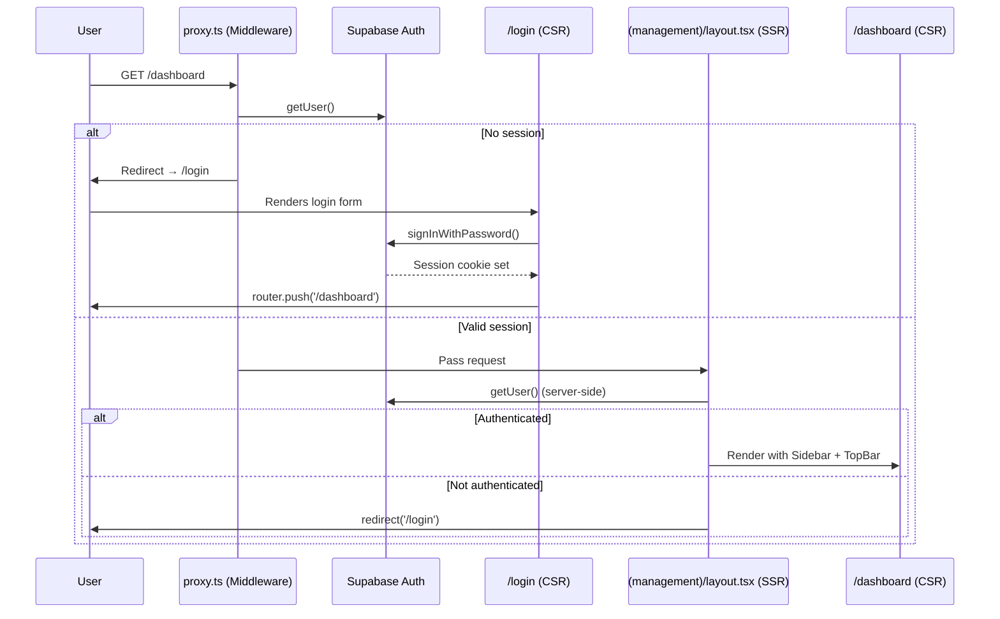
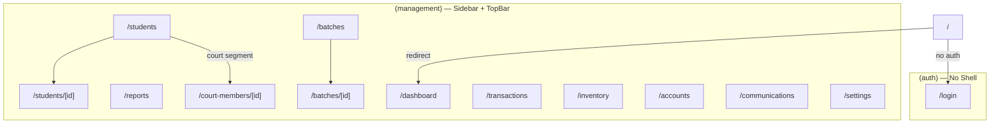
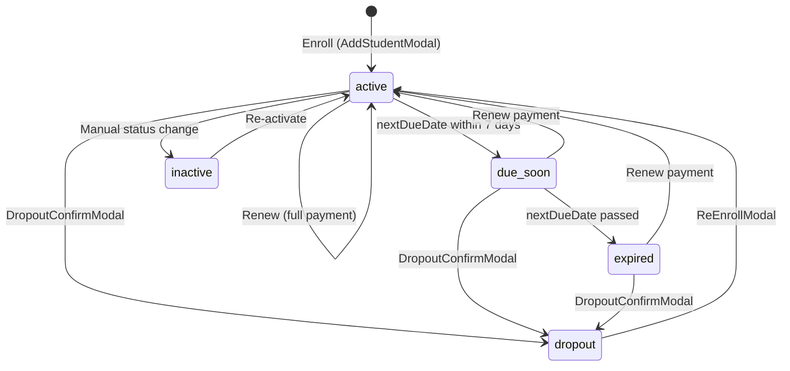
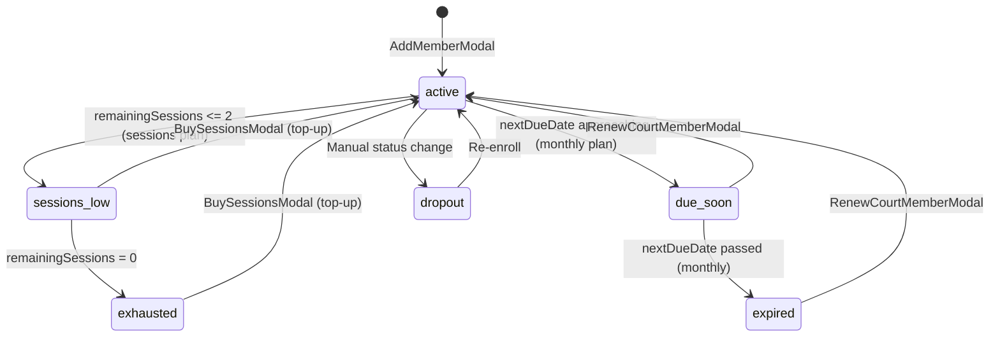

# 🏸 Pro Badminton — Comprehensive Codebase Audit

> **Document Version:** 1.0  
> **Generated:** 01 October 2026  
> **Audit Scope:** Full codebase — architecture, data layer, features, business logic, and known issues

---

## Table of Contents

1. [Project Overview](#1-project-overview)
2. [Tech Stack & External Services](#2-tech-stack--external-services)
3. [Architecture](#3-architecture)
4. [File Structure](#4-file-structure)
5. [Routing & Navigation](#5-routing--navigation)
6. [Data Layer](#6-data-layer)
7. [Features (Page-by-Page)](#7-features-page-by-page)
8. [Design Tokens & Theme](#8-design-tokens--theme)
9. [Component Patterns](#9-component-patterns)
10. [Business Logic](#10-business-logic)
11. [Utility Functions](#11-utility-functions)
12. [Overview Summary](#12-overview-summary)
13. [Known Issues & Inconsistencies ⚠](#13-known-issues--inconsistencies-)

---

## 1. Project Overview

### What It Is

**Pro Badminton** (marketed in-app as **EzyFee**) is a **coaching academy management system** purpose-built for badminton academies and sports facilities in India. It provides a single-pane management dashboard for academy owners to:

- Enroll and manage **coaching students** with membership-based recurring fees
- Manage **court members** with monthly or session-based court access plans
- Track **fee payments**, pending dues, and partial collections
- Record **batch-level attendance** with multi-day insights
- Maintain an **inventory catalog** of sports equipment and merchandise
- Track **income & expenses** as a lightweight double-entry accounts ledger
- Send **WhatsApp communications** (fee reminders, holiday notices, birthday wishes)
- Generate **reports & analytics** covering fees, students, and attendance

### Why It Matters

Small-to-medium badminton academies in India typically manage all operations with spreadsheets, notebooks, or WhatsApp groups. This product digitizes the complete lifecycle — from student enrollment to fee collection to attendance tracking — into a single web application. The **multi-branch** and **staff role** architecture is designed for academies scaling to multiple locations.

### Current State

The application is in a **functional prototype / pre-production** state. The entire frontend is built and operational with rich mock data, but all data lives in-memory (mutable JavaScript arrays). The Supabase backend is configured for authentication only — no CRUD operations hit the database yet.

---

## 2. Tech Stack & External Services

### 2.1 Frameworks & Language

| Layer | Technology | Version |
|---|---|---|
| **Framework** | Next.js (App Router) | `16.3.1` |
| **Language** | TypeScript | `^5` |
| **Runtime** | React | `19.2.8` |
| **Build Tool** | Turbopack (via `next dev`) | — |

### 2.2 UI & Styling

| Tool | Purpose |
|---|---|
| **Tailwind CSS** `v4` | Utility-first CSS framework |
| **PostCSS** (`@tailwindcss/postcss`) | Tailwind v4 integration |
| **Google Fonts** (Inter) | Primary typeface |
| **Lucide React** `^1.34.0` | Icon library (line icons) |
| **Recharts** `^3.10.1` | Charting library (bar charts, pie charts, line charts) |
| **Emoji Picker React** `^4.22.2` | Emoji selection (Communications module) |

### 2.3 Backend & Auth

| Service | Purpose |
|---|---|
| **Supabase** (`@supabase/supabase-js ^2.112.3`) | Authentication (email/password sign-in) |
| **Supabase SSR** (`@supabase/ssr ^0.12.4`) | Server-side auth with cookie management |
| **PostgreSQL** (via Supabase) | Database (schema defined, not yet connected for data) |

### 2.4 Date & Time

| Library | Purpose |
|---|---|
| **date-fns** `^4.4.0` | Date arithmetic, formatting, interval checks |

### 2.5 External Services

| Service | Status | Notes |
|---|---|---|
| **Supabase Auth** | ✅ Active | Email/password authentication is live |
| **Supabase Database** | ⚠ Schema only | Full SQL schema exists but no tables are read/written |
| **WhatsApp Cloud API (Meta)** | 🔲 Stub | API route exists at `/api/whatsapp/send` — logs to console, returns mock response |

### 2.6 Dev Tooling

| Tool | Purpose |
|---|---|
| **ESLint** `^9` + `eslint-config-next` | Linting |
| **TypeScript** strict mode | Type checking |

---

## 3. Architecture

### 3.1 High-Level Architecture

```mermaid
graph TB
    subgraph Client["Browser (Client)"]
        LP["Login Page (CSR)"]
        Pages["Management Pages (CSR)"]
        Modals["Modal Components"]
    end

    subgraph NextJS["Next.js Server"]
        MW["Middleware (proxy.ts)"]
        SL["Server Layout (Auth Guard)"]
        API["API Routes (/api/whatsapp)"]
    end

    subgraph DataLayer["Data Layer (In-Memory)"]
        MD["mock-data.ts (mutable arrays)"]
    end

    subgraph Supabase["Supabase Cloud"]
        Auth["Supabase Auth"]
        DB["PostgreSQL (schema only)"]
    end

    LP -->|signInWithPassword| Auth
    MW -->|getUser()| Auth
    SL -->|getUser()| Auth
    Pages -->|import| MD
    Modals -->|mutate| MD
    API -->|stub| WhatsApp["Meta WhatsApp API"]
```

### 3.2 Rendering Strategies

| Strategy | Where Used | Reason |
|---|---|---|
| **Server Component** | `src/app/(management)/layout.tsx` | Auth guard — calls `supabase.auth.getUser()` and redirects unauthenticated users |
| **Server Component** | `src/app/layout.tsx` | Root layout — sets metadata, imports CSS |
| **Client Component** (`'use client'`) | **Every page and interactive component** | All pages use `useState`, `useEffect`, client-side routing, and direct mock-data mutation |
| **Middleware** | `src/proxy.ts` | Runs on every request — refreshes Supabase session, handles auth redirects for `/`, `/login`, and all protected routes |

> **Key Observation:** The management layout is the *only* true Server Component that performs data fetching (auth). All route pages below it are `'use client'` components that read from the in-memory `mock-data.ts` module.

### 3.3 State Management & Data Flow

```mermaid
graph LR
    A["mock-data.ts<br/>(mutable let arrays)"] -->|import| B["Page Component"]
    B -->|direct mutation<br/>.push(), .splice(), property assignment| A
    B -->|forceUpdate(n => n+1)| B
    B -->|props| C["Modal Component"]
    C -->|callback (onConfirm, onSuccess)| B
    B -->|window.dispatchEvent('settingsChange')| D["TopBar / Other listeners"]
```

**Pattern:** There is no global state management library (no Redux, Zustand, Jotai, or React Context). The entire data layer is a set of **mutable `let`-exported arrays** in `mock-data.ts`. Components:

1. **Import** the arrays directly
2. **Mutate** them in-place (`.push()`, `.splice()`, property assignment)
3. **Force re-render** via `const [, forceUpdate] = useState(0)` and `forceUpdate(n => n + 1)`
4. **Cross-component sync** uses `window.dispatchEvent(new Event('settingsChange'))` for the Settings → TopBar flow

### 3.4 Auth Flow Architecture



**Double Guard:** Authentication is enforced at two layers:
1. **Middleware (`proxy.ts`)** — intercepts every request, redirects unauthenticated users to `/login`, redirects `/` to `/dashboard`, and redirects already-logged-in users away from `/login`
2. **Server Layout (`(management)/layout.tsx`)** — server-side `getUser()` check as a fallback guard

---

## 4. File Structure

```
Pro Badminton/
├── .env.local                          # Supabase credentials & WhatsApp API keys
├── .gitignore                          # Git ignore rules
├── AGENTS.md                           # Next.js agent rules (auto-generated)
├── CLAUDE.md                           # AI assistant context marker
├── README.md                           # Project readme
├── database_schema.sql                 # Full PostgreSQL schema (source of truth)
├── next.config.ts                      # Next.js configuration (⚠ dual export bug)
├── next-env.d.ts                       # Next.js TypeScript declarations
├── tsconfig.json                       # TypeScript compiler configuration
├── eslint.config.mjs                   # ESLint flat config for Next.js
├── postcss.config.mjs                  # PostCSS + Tailwind v4 plugin
├── package.json                        # Dependencies & scripts
├── package-lock.json                   # Dependency lockfile
├── pro_logo.png                        # Academy logo image (1.5MB)
├── scratch.ts                          # Developer scratch/test file
├── scratch.txt                         # Developer scratch notes
├── scratch_accounts.tsx                # Accounts page draft/experiment
│
├── public/                             # Static assets served by Next.js
│   ├── file.svg                        # Default Next.js icon
│   ├── globe.svg                       # Default Next.js icon
│   ├── next.svg                        # Next.js logo
│   ├── vercel.svg                      # Vercel logo
│   └── window.svg                      # Default Next.js icon
│
├── supabase/                           # Supabase configuration directory
│   ├── schema.sql                      # SQL schema (copy of database_schema.sql)
│   └── SCHEMA_NOTES.md                 # Environment & migration notes
│
├── prompts/                            # (Excluded from audit per user request)
│
└── src/                                # Application source code
    ├── proxy.ts                        # Next.js middleware — auth redirects & session refresh
    │
    ├── app/                            # Next.js App Router directory
    │   ├── globals.css                 # Global styles, Tailwind theme tokens, scrollbar
    │   ├── layout.tsx                  # Root layout — metadata, font, body
    │   ├── page.tsx                    # Root page (⚠ default Next.js boilerplate, unreachable)
    │   ├── favicon.ico                 # App favicon
    │   │
    │   ├── (auth)/                     # Auth route group (no sidebar/topbar)
    │   │   └── login/
    │   │       ├── layout.tsx          # Passthrough layout (renders children only)
    │   │       └── page.tsx            # Login page — email/password form (CSR)
    │   │
    │   ├── (management)/               # Protected management route group
    │   │   ├── layout.tsx              # Auth guard layout — Sidebar + TopBar shell (SSR)
    │   │   │
    │   │   ├── dashboard/
    │   │   │   ├── page.tsx            # Dashboard — KPI cards, batch revenue, payment modes
    │   │   │   ├── loading.tsx         # Dashboard skeleton loader
    │   │   │   └── error.tsx           # Dashboard error boundary
    │   │   │
    │   │   ├── students/
    │   │   │   ├── page.tsx            # Members page — coaching & court segments, CRUD
    │   │   │   ├── loading.tsx         # Students list skeleton
    │   │   │   ├── error.tsx           # Students error boundary
    │   │   │   └── [id]/
    │   │   │       └── page.tsx        # Student profile — details, transactions, attendance
    │   │   │
    │   │   ├── batches/
    │   │   │   ├── page.tsx            # Batches list — batch cards with student counts
    │   │   │   ├── loading.tsx         # Batches skeleton
    │   │   │   └── [id]/
    │   │   │       ├── page.tsx        # Batch detail — attendance, students, transactions tabs
    │   │   │       └── loading.tsx     # Batch detail skeleton
    │   │   │
    │   │   ├── court-members/
    │   │   │   └── [id]/
    │   │   │       ├── page.tsx        # Court member profile — details, transactions, check-ins
    │   │   │       └── loading.tsx     # Court member skeleton
    │   │   │
    │   │   ├── transactions/
    │   │   │   ├── page.tsx            # Fee transactions — coaching & court segments
    │   │   │   ├── loading.tsx         # Transactions skeleton
    │   │   │   └── error.tsx           # Transactions error boundary
    │   │   │
    │   │   ├── accounts/
    │   │   │   ├── page.tsx            # Accounts — expenses & income tabs with CRUD
    │   │   │   └── loading.tsx         # Accounts skeleton
    │   │   │
    │   │   ├── inventory/
    │   │   │   ├── page.tsx            # Inventory — product catalog with CRUD
    │   │   │   └── loading.tsx         # Inventory skeleton
    │   │   │
    │   │   ├── reports/
    │   │   │   ├── page.tsx            # Reports hub — fees, students, attendance segments
    │   │   │   └── _components/
    │   │   │       ├── FeesSegment.tsx       # Fee analytics — revenue chart, paid/pending donut
    │   │   │       ├── StudentsSegment.tsx   # Student analytics — growth, age, retention
    │   │   │       └── AttendanceSegment.tsx # Attendance analytics — batch rates, heatmap
    │   │   │
    │   │   ├── communications/
    │   │   │   ├── page.tsx            # WhatsApp templates gallery & detail shell
    │   │   │   └── loading.tsx         # Communications skeleton
    │   │   │
    │   │   └── settings/
    │   │       ├── page.tsx            # Settings hub — academy, branches, staff, permissions
    │   │       ├── loading.tsx         # Settings skeleton
    │   │       ├── error.tsx           # Settings error boundary
    │   │       └── _components/
    │   │           ├── AcademySection.tsx      # Academy name, phone, address, toggles
    │   │           ├── BranchesSection.tsx     # Multi-branch management
    │   │           ├── StaffSection.tsx        # Staff member CRUD & role assignment
    │   │           ├── PermissionsMatrix.tsx   # Role-based permissions table
    │   │           ├── MembershipSection.tsx   # Coaching membership plan CRUD
    │   │           └── EventsSection.tsx       # Upcoming events management
    │   │
    │   └── api/
    │       └── whatsapp/
    │           └── send/
    │               └── route.ts        # WhatsApp send stub — POST handler (console.log)
    │
    ├── components/                     # Shared React components
    │   ├── .gitkeep
    │   │
    │   ├── layout/                     # App shell components
    │   │   ├── Sidebar.tsx             # Left navigation — nav items, brand, sign out
    │   │   ├── TopBar.tsx              # Header bar — branch switcher, live clock
    │   │   └── LiveClock.tsx           # Real-time IST clock with pulse indicator
    │   │
    │   ├── ui/                         # Generic UI primitives
    │   │   ├── StatusBadge.tsx         # Colored status pill (Available/Booked/Blocked)
    │   │   └── ConfirmDialog.tsx       # Empty placeholder component
    │   │
    │   ├── students/                   # Student-domain modals
    │   │   ├── AddStudentModal.tsx     # New student enrollment with fee & partial payment
    │   │   ├── EditStudentModal.tsx    # Edit student details (phone, batch, notes)
    │   │   ├── ReEnrollModal.tsx       # Re-enroll a dropout student with fresh membership
    │   │   ├── DropoutConfirmModal.tsx # Confirm dropout with reason capture
    │   │   └── CollectRemainingModal.tsx # Collect pending partial payment balance
    │   │
    │   ├── coaching/                   # Coaching-domain modals
    │   │   └── RenewModal.tsx          # Renew membership — period selection, partial pay
    │   │
    │   ├── court/                      # Court-domain modals
    │   │   ├── AddMemberModal.tsx      # New court member — sessions or monthly plan
    │   │   ├── EditCourtMemberModal.tsx # Edit court member details
    │   │   ├── RenewCourtMemberModal.tsx # Renew court membership
    │   │   ├── BuySessionsModal.tsx    # Top-up sessions for session-based members
    │   │   └── CollectCourtPaymentModal.tsx # Collect pending court fee payment
    │   │
    │   ├── accounts/                   # Accounts & inventory modals
    │   │   ├── AccountEntryModal.tsx   # Add/edit expense or income entry
    │   │   ├── AddInventoryModal.tsx   # Add new inventory item
    │   │   ├── EditInventoryModal.tsx  # Edit inventory item details
    │   │   └── InventoryDetailsModal.tsx # View inventory item details (read-only)
    │   │
    │   └── communications/             # WhatsApp messaging components
    │       ├── TemplateCard.tsx         # Template preview card in gallery
    │       ├── TemplateDetailShell.tsx  # Detail view wrapper with back navigation
    │       ├── TemplateHistory.tsx      # Message send history log
    │       └── templates/              # Individual template implementations (empty dir)
    │
    └── lib/                            # Core library & data
        ├── mock-data.ts                # All type definitions, seed data, mutable state arrays
        ├── utils.ts                    # Shared utility functions (currency, date, age)
        └── supabase/
            ├── client.ts              # Supabase browser client (createBrowserClient)
            ├── server.ts              # Supabase server client (createServerClient + cookies)
            └── database.types.ts      # Auto-generated Supabase database types
```

---

## 5. Routing & Navigation

### 5.1 Route Map



### 5.2 Routes

| Route | Page | Description |
|---|---|---|
| `/` | — | Redirected to `/dashboard` (auth) or `/login` (unauth) by middleware |
| `/login` | `LoginPage` | Email/password authentication form |
| `/dashboard` | `DashboardPage` | KPI cards, batch revenue bars, payment mode breakdown |
| `/reports` | `ReportsPage` | Analytics hub with fees, students, and attendance segments |
| `/students` | `StudentsPage` | Member directory with coaching/court segment toggle |
| `/students/[id]` | `StudentProfilePage` | Individual student profile — details, transactions, attendance |
| `/batches` | `BatchesPage` | Batch listing with cards |
| `/batches/[id]` | `BatchDetailPage` | Batch detail — attendance marking, students, transactions |
| `/court-members/[id]` | `CourtMemberProfilePage` | Court member profile — details, transactions, check-ins |
| `/transactions` | `TransactionsPage` | Fee transaction ledger with coaching/court segments |
| `/inventory` | `InventoryPage` | Product catalog with stock tracking |
| `/accounts` | `AccountsPage` | Income & expense tracker |
| `/communications` | `CommunicationsPage` | WhatsApp template gallery and composer |
| `/settings` | `SettingsPage` | Academy configuration, branches, staff, permissions |

### 5.3 Sidebar Navigation Items

Defined in `src/components/layout/Sidebar.tsx` → `NAV_ITEMS[]`:

| # | Label | Route | Icon | Notes |
|---|---|---|---|---|
| 1 | Dashboard | `/dashboard` | `LayoutDashboard` | — |
| 2 | Reports & Analysis | `/reports` | `PieChart` | — |
| 3 | Members | `/students` | `Users` | Labelled "Members" in nav, page shows "Students" |
| 4 | Batches | `/batches` | `LayoutGrid` | — |
| 5 | Fee Transactions | `/transactions` | `Receipt` | — |
| 6 | Inventory | `/inventory` | `Package` | — |
| 7 | Accounts | `/accounts` | `BookOpen` | — |
| — | *divider* | — | — | Visual separator |
| 8 | Settings | `/settings` | `Settings` | — |

**Footer:** User avatar (email initial), email display, "Staff" label, and Sign Out button.

### 5.4 Navigation Patterns

- **Sidebar-driven:** All primary navigation via the fixed left sidebar. Active route highlighted with `bg-white/10` + left accent border.
- **Segment toggle:** `/students` and `/transactions` pages have internal **coaching ↔ court** segment toggles (pill buttons), not separate routes.
- **Drill-down:** Student/batch/court-member detail pages are accessed via `router.push('/students/[id]')` from list rows. Back navigation uses `router.push()` or `ArrowLeft` button.
- **Modals:** All CRUD operations (add, edit, renew, dropout) are performed via **overlay modals** — no separate routes for forms.
- **Tab-based sub-views:** Detail pages use internal tab state (e.g., `details | transactions | attendance`) rather than URL-based tabs.

---

## 6. Data Layer

### 6.1 Data Storage Layer

The application has a **split data architecture**:

| Layer | Technology | Status |
|---|---|---|
| **Authentication** | Supabase Auth (PostgreSQL-backed) | ✅ Live — email/password sessions stored in Supabase |
| **Application Data** | In-memory mutable arrays (`mock-data.ts`) | ⚠ All data lives in RAM — lost on page refresh/navigation |
| **Database Schema** | PostgreSQL DDL (`database_schema.sql`) | 📝 Schema defined, not deployed or connected |
| **Type Definitions** | `database.types.ts` (generated) + `mock-data.ts` (hand-written) | ⚠ Types drift — mock types use embedded arrays vs normalized tables |

**How data flows:**
1. All domain types and seed data are exported from `src/lib/mock-data.ts`
2. Page components `import` arrays directly and **mutate them in-place**
3. Components call `forceUpdate(n => n + 1)` to trigger re-renders
4. **No persistence** — refreshing the browser resets all data to seed state

### 6.2 Type Definitions

#### `Student`
```typescript
type Student = {
  id: string
  name: string
  phone: string
  alternatePhone: string
  guardianName: string
  membershipTypeId: string          // FK → MembershipType.id
  currentBatch: string              // Batch name string (not ID)
  fees: number                      // Computed/overridden monthly fee
  startDate: string                 // Original enrollment date (yyyy-MM-dd)
  membershipStartDate: string       // Current period start date
  nextDueDate: string               // When next payment is due
  status: 'active' | 'due-soon' | 'expired' | 'inactive' | 'dropout'
  dateOfBirth?: string
  enrollmentSource?: 'walk-in' | 'referral' | 'social-media' | 'other'
  dropoutReason?: string
  dropoutDate?: string
  pendingAmount: number             // Outstanding partial payment balance
  internalNotes: string
  paymentHistory: PaymentEntry[]    // ⚠ Embedded array (denormalized)
}
```

#### `PaymentEntry`
```typescript
type PaymentEntry = {
  id: string
  date: string                      // yyyy-MM-dd
  amount: number                    // Amount actually paid
  remainingAmount: number           // Amount still owed from this entry
  paymentType: 'full' | 'partial' | 'advance'
  monthsCovered: number             // Number of membership periods covered
  paymentMethod: 'cash' | 'upi' | 'card' | 'other'
  status: 'active' | 'inactive' | 'deleted'
  note: string
}
```

#### `MembershipType`
```typescript
type MembershipType = {
  id: string                        // e.g., 'monthly', 'quarterly', 'annual'
  name: string
  durationType: 'months' | 'days'
  duration: number                  // e.g., 1, 3, 12
  price: number                     // Base price in ₹
}
```

#### `Batch`
```typescript
interface Batch {
  id: string
  name: string                      // e.g., 'Morning', 'Evening'
  branchId: string                  // FK → Branch.id
  days: string[]                    // e.g., ['Monday', 'Wednesday', 'Friday']
  fees?: number                     // Optional batch-specific fee override
  description?: string              // e.g., '6:00 AM – 8:00 AM'
}
```

#### `AttendanceRecord`
```typescript
type AttendanceRecord = {
  id: string                        // Compound: `${batchId}-${yyyy-MM-dd}`
  batchId: string
  date: string                      // yyyy-MM-dd
  records: Record<string, 'present' | 'absent'>  // studentId → status map
}
```

#### `AccountEntry`
```typescript
type AccountEntry = {
  id: string
  date: string                      // yyyy-MM-dd
  category: string                  // From EXPENSE_CATEGORIES or INCOME_CATEGORIES
  description: string
  amount: number                    // Always positive
  paymentMethod: 'cash' | 'upi' | 'card' | 'other'
  notes?: string
}
```

#### `InventoryItem`
```typescript
type InventoryItem = {
  id: string
  sku: string                       // Stock keeping unit code
  name: string
  category: string                  // From BUILTIN_INVENTORY_CATEGORIES
  description: string
  unit: string                      // e.g., 'tube', 'piece', 'pair'
  quantity: number                  // Current stock level
  price: number                     // Purchase price in ₹
  sellingPrice: number              // Selling price in ₹
  icon?: string                     // Optional product image
}
```

#### `CourtPlan`
```typescript
type CourtPlan = {
  id: string
  name: string                      // e.g., 'Monthly Unlimited', 'Session Pack — 10'
  planType: 'monthly' | 'sessions'
  price: number
  durationMonths?: number           // For monthly plans
  totalSessions?: number            // For session plans
  validityDays?: number             // Session pack expiry window
}
```

#### `CourtPaymentEntry`
```typescript
type CourtPaymentEntry = {
  id: string
  date: string
  amount: number
  paymentMethod: 'cash' | 'upi' | 'card' | 'other'
  entryType: 'new' | 'renewal' | 'session-topup'
  status: 'active' | 'deleted'
  note?: string
}
```

#### `CourtMember`
```typescript
type CourtMember = {
  id: string
  name: string
  phone: string
  planId?: string                   // FK → CourtPlan.id
  durationMonths?: number
  planType: 'monthly' | 'sessions'
  joiningDate: string
  membershipStartDate?: string      // For monthly plans
  nextDueDate?: string              // For monthly plans
  totalSessions?: number            // For session plans
  remainingSessions?: number        // For session plans
  status: 'active' | 'due-soon' | 'expired' | 'sessions-low' | 'exhausted' | 'inactive' | 'dropout'
  amountPaid: number
  pendingAmount?: number
  notes?: string
  paymentHistory: CourtPaymentEntry[]           // ⚠ Embedded
  checkInHistory: Array<{ id: string; date: string; sessionsAfter: number }>  // ⚠ Embedded
}
```

#### `Settings`
```typescript
type Settings = {
  courtMembershipEnabled: boolean   // Toggle court segment on/off
  courtPlans: CourtPlan[]
  courtName: string                 // Academy display name
  tenantPhone?: string
  tenantAddress?: string
  tenantTimezone?: string
  multiBranchEnabled: boolean       // Toggle multi-branch features
  branches: Branch[]
  staffMembers: StaffMember[]
  membershipTypes: MembershipType[]
  batches: string[]                 // Batch name strings
  feeReminderEnabled: boolean       // WhatsApp auto fee reminders
  feeAckEnabled: boolean            // WhatsApp payment acknowledgements
  birthdayWishEnabled: boolean      // WhatsApp birthday messages
}
```

### 6.3 Seed Data

The application ships with the following pre-populated data in `mock-data.ts`:

| Entity | Count | Notable Items |
|---|---|---|
| **Branches** | 3 | Main Center, Kondapur Center (from `mockBranches`); Indiranagar, Whitefield, Koramangala (from `mockSettings.branches`) |
| **Staff** | 3–4 | Owner, Coach, Accountant/Manager roles |
| **Membership Types** | 3 | Monthly (₹1,500), Quarterly (₹4,000), Annual (₹14,000) |
| **Batches** | 2 | Morning (6 days/week, ₹1,500), Evening (4 days/week, ₹1,500) |
| **Students** | 12 | s1–s12 spanning all statuses: active, due-soon, expired, dropout |
| **Court Plans** | 3 | Monthly Unlimited (₹3,000), Session Pack 10 (₹1,500), Session Pack 20 (₹2,500) |
| **Court Members** | 3 | Monthly active, sessions-low, exhausted |
| **Expenses** | 6 | Shuttlecocks, utilities, court rent, equipment, coaching staff |
| **Income Entries** | 4 | Shuttle sales, restringing, equipment sales |
| **Inventory Items** | 6 | Yonex shuttles, racquets, shoes, grip tape, T-shirts |
| **Attendance Records** | ~14 | Auto-seeded for last 7 days × 2 batches (85% present rate) |
| **Events** | 3 | Tournament, sports meet, maintenance day |
| **Message Logs** | 6 | Historical WhatsApp message send records |

### 6.4 Constants

```typescript
// Expense Categories
const EXPENSE_CATEGORIES = [
  'Shuttlecocks', 'Equipment & Gear', 'Court Rent', 'Coaching Staff',
  'Utilities', 'Maintenance & Repairs', 'Marketing',
  'Tournament Expenses', 'Miscellaneous'
]

// Income Categories (non-fee)
const INCOME_CATEGORIES = [
  'Court Rental', 'Membership Fees', 'Equipment Sales', 'Shuttle Sales',
  'Racket Restringing', 'Merchandise', 'Sponsorship',
  'Tournament Entry', 'Other'
]

// Built-in Inventory Categories
const BUILTIN_INVENTORY_CATEGORIES = [
  'Racquet Sports', 'Footwear', 'Apparel', 'Accessories / Miscellaneous'
]

// Unit Presets (Inventory)
const UNIT_PRESETS = ['piece', 'tube', 'pair', 'roll', 'box', 'set']

// Permission Matrix (11 modules × 5 roles)
const PERMISSION_MATRIX: ModulePermission[] = [
  { module: 'Dashboard',        owner: 'full', manager: 'full', coach: 'view', accountant: 'view', receptionist: 'view' },
  { module: 'Students',         owner: 'full', manager: 'full', coach: 'view', accountant: 'view', receptionist: 'partial' },
  { module: 'Batches',          owner: 'full', manager: 'full', coach: 'view', accountant: 'none', receptionist: 'none' },
  { module: 'Attendance',       owner: 'full', manager: 'full', coach: 'mark', accountant: 'none', receptionist: 'none' },
  { module: 'Fee Transactions', owner: 'full', manager: 'full', coach: 'none', accountant: 'full', receptionist: 'collect' },
  { module: 'Accounts',         owner: 'full', manager: 'view', coach: 'none', accountant: 'full', receptionist: 'none' },
  { module: 'Inventory',        owner: 'full', manager: 'full', coach: 'none', accountant: 'view', receptionist: 'none' },
  { module: 'Court Members',    owner: 'full', manager: 'full', coach: 'none', accountant: 'view', receptionist: 'collect' },
  { module: 'Events',           owner: 'full', manager: 'full', coach: 'view', accountant: 'none', receptionist: 'view' },
  { module: 'Settings',         owner: 'full', manager: 'partial', coach: 'none', accountant: 'none', receptionist: 'none' },
  { module: 'Staff Management', owner: 'full', manager: 'view', coach: 'none', accountant: 'none', receptionist: 'none' },
]

// Staff Roles
type StaffRole = 'owner' | 'manager' | 'coach' | 'accountant' | 'receptionist'

// Payment Methods
type PaymentMethod = 'cash' | 'upi' | 'card' | 'other'
```

---

## 7. Features (Page-by-Page)

### 7.1 Login (`/login`)

- **Branded card** with EzyFee logo, "Staff Management Portal" subtitle
- **Email/password form** with validation and error display
- **Supabase `signInWithPassword()`** integration
- Loading spinner during authentication
- Redirects to `/dashboard` on success
- "Staff access only" footer notice

### 7.2 Dashboard (`/dashboard`)

#### KPI Cards (4 stat cards)

| Card | Metric | Color | Logic |
|---|---|---|---|
| **Collected** | Sum of all payment amounts in selected period | 🟢 Emerald | Filters `paymentHistory` by date range, excludes `deleted` |
| **Due — Current** | Total outstanding amount across all non-dropout students | 🟡 Yellow | `pendingAmount + fees` for expired/due-soon students. **Not date-filtered** |
| **Active Batches** | Count of configured batches | ⬜ Neutral | `mockSettings.batches.length` |
| **Total Students** | Count of active + due-soon + expired students | ⬜ Neutral | Excludes dropout/inactive. Shows "{n} off-court" subtitle |

#### Date Filter
- **This Month** / **Last Month** / **Custom** range toggle
- Custom range shows two date pickers (from/to)

#### Batch Revenue Section
- Per-batch progress bar showing **collected vs expected** revenue
- Color-coded: green (≥80%), yellow (≥50%), red (<50%)
- Shows student count per batch and remaining amount

#### Payment Modes Card
- **Segmented horizontal bar** showing cash/UPI/card/other proportions
- Color legend: Cash (emerald), UPI (amber), Card (blue), Other (slate)
- Percentage and absolute amount per mode

### 7.3 Students/Members Page (`/students`)

#### Segment Toggle
- **Coaching** ↔ **Court** segment pills at top
- Court segment only visible when `courtMembershipEnabled` is true in settings

#### Coaching Segment

**Tabs:**
| Tab | Content |
|---|---|
| **Active** | Students with status `active`, `due-soon`, or `expired` |
| **Inactive** | Students with status `inactive` |
| **Dropout** | Students with status `dropout` — shows dropout reason & date |

**Features:**
- Search by name or phone
- Batch filter dropdown
- "Add Student" button → `AddStudentModal`
- Per-student action menu (three-dot `MoreVertical`):
  - ✏️ **Edit** → `EditStudentModal`
  - 🔄 **Renew** → `RenewModal`
  - 🚪 **Move to Dropout** → `DropoutConfirmModal`
  - 🗑️ **Delete** with dues-check warning
- Student row click → navigates to `/students/[id]`
- Status color badges: green (active), yellow (due-soon), red (expired), gray (inactive), slate (dropout)

#### Court Segment

**Tabs:** Active / Inactive / Dropout

**Features:**
- Plan type filter: All / Monthly / Sessions
- Search by name or phone
- "Add Member" → `AddMemberModal`
- **Log In** button for session-based members (deducts 1 session, updates status)
- Undo log-in strip (5-second auto-dismiss)
- Per-member actions: Edit, Renew, Delete
- Member row click → navigates to `/court-members/[id]`

### 7.4 Student Profile (`/students/[id]`)

**Header Card:**
- Student avatar (initial), name, phone, status badge
- Action buttons: Edit, Renew, Collect Remaining (if `pendingAmount > 0`)
- Summary stats: Total Collected, Total Due, Membership Type, Current Batch

**Tabs:**

#### Details Tab
| Field | Source |
|---|---|
| Phone | `student.phone` |
| Alternate Phone | `student.alternatePhone` |
| Guardian | `student.guardianName` |
| Date of Birth + Age | `student.dateOfBirth`, computed via `calcAge()` |
| Enrollment Source | `student.enrollmentSource` |
| Membership Plan | Looked up from `mockSettings.membershipTypes` |
| Current Batch | `student.currentBatch` |
| Fees | `student.fees` |
| Start Date | `student.startDate` |
| Membership Start | `student.membershipStartDate` |
| Next Due Date | `student.nextDueDate` |
| Pending Amount | `student.pendingAmount` |
| Internal Notes | `student.internalNotes` |

#### Transactions Tab
- **Sub-tabs:** Recent (date-filtered) | Paid | Pending | Partial
- Date filter: Current Month / Last Month / Custom
- Transaction rows show: date, amount, payment type, payment method, status
- **Void** action on individual transactions (sets `status: 'deleted'`)
- Summary stats at top: total collected, total due

#### Attendance Tab
- **Calendar heatmap** (month view) — green (present), red (absent), gray (no record)
- Month/year navigation with `ChevronLeft` / `ChevronRight`
- Attendance percentage for the viewed month
- Day labels and grid layout

### 7.5 Batches (`/batches`)

- Batch **cards** with: name, description, schedule days (pill badges), student count, fee amount
- Click → navigates to `/batches/[id]`
- "Create Batch" → inline form or modal (within page)

### 7.6 Batch Detail (`/batches/[id]`)

**Header:** Batch name, description, schedule days, student count

**Tabs:**

#### Attendance Tab
- **Two view modes:** Insights | Marking
- **Insights mode:**
  - Filter: Last 5 / Last 10 / Last 30 / This Month
  - Per-student attendance grid with present/absent indicators
  - Batch average attendance percentage
  - Searchable student list
- **Marking mode:**
  - Date picker for attendance date
  - Per-student present/absent toggle buttons
  - Bulk "Mark All Present" / "Mark All Absent"
  - Save attendance with dirty-state tracking

#### Students Tab
- List of students assigned to this batch (non-dropout)
- Search by name or phone
- Per-student status badges
- Add Student → `AddStudentModal` with pre-filled batch

#### Transactions Tab
- Fee transaction history for all students in this batch
- Same sub-tabs as student profile: Recent / Paid / Pending / Partial
- Date range filter
- Renew / Collect Remaining actions inline
- Void transaction capability

### 7.7 Fee Transactions (`/transactions`)

#### Segment Toggle: Coaching ↔ Court

#### Coaching Segment
- **Tabs:** Recent | Paid | Pending | Partial
- **Date filter:** Current Month / Last Month / Current FY / Last FY / Custom
- **Search** by student name or phone
- Per-row actions: Renew, Collect Remaining, Void
- **Bulk Collect** mode on Pending tab — checkbox selection, bulk payment method, confirm modal

#### Court Segment
- Same tab structure: Recent | Paid | Pending | Partial
- **Date filter** for court payment history
- Per-row actions: Renew court membership

### 7.8 Accounts (`/accounts`)

#### Tabs: Expenses | Income

**Common features:**
- Summary cards: Total Expenses, Total Income, Net Balance (with trend icons)
- Date filter: Current Month / Last Month / Custom
- Search by description or category
- "Add Entry" → `AccountEntryModal` (shared for both expense and income)
- Per-entry actions: Edit, Delete (with confirmation)
- Category display with icons
- Payment method badges (UPI, Card, Cash)

#### Expense-specific
- Categories from `EXPENSE_CATEGORIES` + user-created custom categories
- Delete confirmation modal

#### Income-specific
- Categories from `INCOME_CATEGORIES`
- Same CRUD pattern as expenses

### 7.9 Inventory (`/inventory`)

- **Summary cards:** Total Items, Low Stock (4–7), Critical Stock (1–3), Out of Stock (0)
- **Category filter** dropdown (built-in + custom categories)
- **Sort:** Name A-Z, Name Z-A, Price Low-High, Price High-Low, Quantity Low-High
- **Search** by item name or SKU
- Per-item **3-dot action menu:** View Details, Edit, Delete
- "Add Item" → `AddInventoryModal` (with custom category creation)
- `InventoryDetailsModal` — read-only item view
- `EditInventoryModal` — full edit form
- Stock level color indicators: green (adequate), yellow (low), red (critical/out)

### 7.10 Settings (`/settings`)

#### Sections:

| Section | Component | Features |
|---|---|---|
| **Academy & Branding** | `AcademySection` | Edit academy name, phone, address; Toggle **Court Membership** on/off; Toggle **Multi-Branch** on/off |
| **Branches** | `BranchesSection` | Add/edit/deactivate branches; Set primary branch. *Only visible when multi-branch is enabled* |
| **Staff & Team** | `StaffSection` | Invite staff members, assign roles (`owner/manager/coach/accountant/receptionist`), assign branches, manage status (`active/invited/suspended`) |
| **Permissions** | `PermissionsMatrix` | Read-only table showing module access levels per role (`full/view/collect/mark/partial/none`) |
| **Membership Plans** | `MembershipSection` | CRUD for coaching membership plans — name, duration type, duration, price |
| **Events** | `EventsSection` | CRUD for upcoming events — name, type, date, description |

### 7.11 Reports & Analysis (`/reports`)

#### Segment Tabs: Fees | Students | Attendance

#### Fees Segment (`FeesSegment`)
- **Monthly Revenue Bar Chart** — 3-month / 6-month / custom range. Color-coded bars (current month highlighted)
- **Paid vs Pending Donut** — with batch filter dropdown. Shows paid/pending counts and amounts
- **Payment Mode Distribution Donut** — cash, UPI, card, other breakdown with percentages
- **Batch Revenue Table** — per-batch expected/collected/remaining with progress percentage
- **Outstanding Students Table** — students with pending dues sorted by amount, shows batch, status, days overdue

#### Students Segment (`StudentsSegment`)
- **Growth Trend Bar Chart** — new enrollments vs exits per month (3m/6m/custom)
- **Enrollment Trend Line Chart** — total student count over 12 months (hardcoded mock data)
- **Age Distribution Bar Chart** — buckets: Under 9, 9–12, 13–17, 18–21, 22+
- **Status Breakdown Donut** — active/due-soon/expired/inactive/dropout proportions
- **Retention Rate** — computed active vs total percentage
- **Recent Dropouts Table** — name, phone, dropout date, reason

#### Attendance Segment (`AttendanceSegment`)
- **Batch Attendance Rate Bar Chart** — per-batch average attendance rate with filter (today/yesterday/this-week/this-month/last-month/custom)
- **Present vs Absent Donut** — overall split with unique student counts
- **Student Attendance Overview** — monthly table with per-student attendance count, percentage, and classification (Excellent/Good/Below Threshold/At Risk). Customizable threshold (50/60/70/80/custom). Top N selector (3/5/10)

### 7.12 Communications (`/communications`)

- **Template Gallery** — 6 WhatsApp message templates shown as cards:
  1. **Fee Reminder** (automated) — targets due-soon/expired students
  2. **Fee Acknowledgement** (automated) — sent after payment recorded
  3. **Declare Holiday** (manual) — single-day notice to all active students
  4. **Declare Holidays** (manual) — multi-day range notice
  5. **Class Cancellation** (manual) — batch-specific cancellation notice
  6. **Birthday Wish** (automated) — birthday greeting

- **Template Detail Shell** — drill-into view with back navigation, template name, and history
- **Message History** (`TemplateHistory`) — log of past sends with recipient count, status (sent/delivered/read/failed), trigger type (manual/auto)
- **WhatsApp API** — stub at `/api/whatsapp/send` (logs to console, returns mock ID)

---

## 8. Design Tokens & Theme

### 8.1 Color Palette

Defined in `globals.css` via `@theme` directive (Tailwind v4):

#### Page & Surface Colors
| Token | Value | Usage |
|---|---|---|
| `--color-so-bg` | `#F4F6FA` | Page background |
| `--color-so-card` | `#FFFFFF` | Card/panel background |
| `--color-so-surface` | `#EEF1F8` | Input backgrounds, secondary surfaces |

#### Border Colors
| Token | Value | Usage |
|---|---|---|
| `--color-so-border` | `#DDE3EE` | Primary borders, card outlines |
| `--color-so-border-subtle` | `#EEF1F8` | Subtle dividers |

#### Text Colors
| Token | Value | Usage |
|---|---|---|
| `--color-so-text` | `#0F1729` | Primary text (near-black) |
| `--color-so-muted` | `#64748B` | Secondary text, labels |
| `--color-so-grey` | `#484F58` | Tertiary text, placeholders |

#### Accent (Primary Blue)
| Token | Value | Usage |
|---|---|---|
| `--color-so-accent` | `#3B6BE8` | Primary buttons, active states, links |
| `--color-so-accent-hover` | `#2563EB` | Button hover state |
| `--color-so-accent-subtle` | `rgba(59,107,232,0.08)` | Light accent backgrounds |
| `--color-so-accent-muted` | `rgba(59,107,232,0.15)` | Medium accent backgrounds |
| `--color-so-accent-text` | `#FFFFFF` | Text on accent backgrounds |

#### Semantic Colors
| Token | Value | Usage |
|---|---|---|
| `--color-so-emerald` | `#059669` | Success, active, collected |
| `--color-so-emerald-subtle` | `rgba(5,150,105,0.10)` | Success badge backgrounds |
| `--color-so-red` | `#DC2626` | Error, expired, destructive |
| `--color-so-red-subtle` | `rgba(220,38,38,0.10)` | Error badge backgrounds |
| `--color-so-yellow` | `#D97706` | Warning, due-soon, pending |
| `--color-so-yellow-subtle` | `rgba(217,119,6,0.10)` | Warning badge backgrounds |

#### Navigation
| Token | Value | Usage |
|---|---|---|
| `--color-so-nav` | `#232E44` | Sidebar background (dark navy) |
| `--color-so-nav-text` | `#FFFFFF` | Sidebar text |

#### Categorical Badge Colors
| Token | Value | Usage |
|---|---|---|
| `--color-so-blue` | `#58A6FF` | Informational badges |
| `--color-so-purple` | `#BC8CFF` | Premium/special badges |
| `--color-so-orange` | `#FFA657` | Attention badges |

### 8.2 Typography

| Property | Value |
|---|---|
| **Primary Font** | `'Inter'` (Google Fonts, weights: 400, 500, 600, 700) |
| **Fallback** | `system-ui, sans-serif` |
| **Font Smoothing** | `-webkit-font-smoothing: antialiased` |
| **CSS Variable** | `--font-sans: 'Inter', system-ui, sans-serif` |

**Text Sizes Used (via Tailwind classes):**
- `text-2xl font-bold` — Page titles
- `text-lg font-semibold` — Section headings
- `text-sm font-medium` — Body text, nav items
- `text-xs font-semibold uppercase tracking-wider` — Labels, stat card headers
- `text-[11px]` — Micro text, helper notes
- `text-[10px] font-bold uppercase tracking-wider` — Tiny badges (UPI, Card)

### 8.3 Other Global Styles

#### Selection Highlight
```css
::selection {
  background-color: rgba(59, 107, 232, 0.20);
  color: #0F1729;
}
```

#### Scrollbar (WebKit)
```css
::-webkit-scrollbar { width: 5px; }
::-webkit-scrollbar-track { background: #FFFFFF; }
::-webkit-scrollbar-thumb { background: #DDE3EE; border-radius: 4px; }
::-webkit-scrollbar-thumb:hover { background: #3B6BE8; }
```

#### Input Spinners
```css
input[type='number']::-webkit-inner-spin-button,
input[type='number']::-webkit-outer-spin-button {
  -webkit-appearance: none;
}
```

### 8.4 Common UI Patterns

| Pattern | Implementation |
|---|---|
| **Card** | `bg-so-card border border-so-border rounded-xl shadow-sm p-5` |
| **Card (large)** | `bg-so-card border border-so-border rounded-2xl p-6 shadow-sm` |
| **Primary Button** | `bg-so-accent hover:bg-so-accent-hover text-white font-semibold rounded-lg` |
| **Secondary Button** | `border border-so-border text-so-muted hover:border-so-accent rounded-lg` |
| **Pill Button** | `px-3 py-1.5 text-xs font-semibold rounded-full` |
| **Input** | `bg-so-surface border border-so-border rounded-lg px-3 py-2.5 text-sm focus:ring-1 focus:ring-so-accent` |
| **Label** | `text-xs font-medium text-so-muted uppercase tracking-wide` |
| **Modal Overlay** | `fixed inset-0 z-50 bg-black/50 backdrop-blur-sm` |
| **Toast** | Positioned at bottom, auto-dismiss after 3s, success (green) or error (red) |

---

## 9. Component Patterns

### 9.1 Layout Components

| Component | File | Purpose |
|---|---|---|
| **Sidebar** | `src/components/layout/Sidebar.tsx` | Fixed left navigation (w-64, h-screen). Brand logo, nav items, user info, sign-out. Uses `usePathname()` for active highlighting. |
| **TopBar** | `src/components/layout/TopBar.tsx` | Right-aligned header bar. Branch switcher dropdown (when multi-branch enabled), live clock. |
| **LiveClock** | `src/components/layout/LiveClock.tsx` | Real-time IST clock (`setInterval` 1s). Shows pulsing blue dot indicator. Uses `Asia/Kolkata` timezone. |

### 9.2 Modal Components

| Modal | File | Purpose | Key Props |
|---|---|---|---|
| **AddStudentModal** | `students/AddStudentModal.tsx` | Enroll new coaching student | `onClose`, `onSuccess`, `defaultBatch?` |
| **EditStudentModal** | `students/EditStudentModal.tsx` | Edit student details | `student`, `onClose`, `onSave` |
| **ReEnrollModal** | `students/ReEnrollModal.tsx` | Re-enroll dropout student | `student`, `onClose`, `onConfirm` |
| **DropoutConfirmModal** | `students/DropoutConfirmModal.tsx` | Confirm dropout with reason | `student`, `onClose`, `onConfirm` |
| **CollectRemainingModal** | `students/CollectRemainingModal.tsx` | Collect pending partial balance | `student`, `onClose`, `onConfirm` |
| **RenewModal** | `coaching/RenewModal.tsx` | Renew coaching membership | `student`, `isCollectingRemaining?`, `onClose`, `onConfirm` |
| **AddMemberModal** | `court/AddMemberModal.tsx` | Add new court member | `onClose`, `onSuccess` |
| **EditCourtMemberModal** | `court/EditCourtMemberModal.tsx` | Edit court member | `member`, `onClose`, `onSave` |
| **RenewCourtMemberModal** | `court/RenewCourtMemberModal.tsx` | Renew court membership | `member`, `onClose`, `onConfirm` |
| **BuySessionsModal** | `court/BuySessionsModal.tsx` | Top-up court sessions | `member`, `onClose`, `onConfirm` |
| **CollectCourtPaymentModal** | `court/CollectCourtPaymentModal.tsx` | Collect court payment | `member`, `onClose`, `onConfirm` |
| **AccountEntryModal** | `accounts/AccountEntryModal.tsx` | Add/edit expense or income | `type`, `entry?`, `onClose`, `onSave` |
| **AddInventoryModal** | `accounts/AddInventoryModal.tsx` | Add inventory item | `onClose`, `onSave` |
| **EditInventoryModal** | `accounts/EditInventoryModal.tsx` | Edit inventory item | `item`, `onClose`, `onSave` |
| **InventoryDetailsModal** | `accounts/InventoryDetailsModal.tsx` | View inventory details | `item`, `onClose` |

### 9.3 UI Primitives

| Component | File | Purpose |
|---|---|---|
| **StatusBadge** | `ui/StatusBadge.tsx` | Renders colored pill badge based on status string (Available/Booked/Blocked) |
| **ConfirmDialog** | `ui/ConfirmDialog.tsx` | Empty placeholder (`<div />`) — not implemented |

### 9.4 Common UI Patterns

| Pattern | Implementation |
|---|---|
| **Tab switching** | `useState<TabType>` with conditional rendering. Tabs styled as pills or underlined buttons. |
| **Search** | `useState('')` with `.filter()` on name/phone/description. Search icon + clear button. |
| **Date range filter** | Enum state (`'currentMonth' | 'lastMonth' | 'custom'`), computed `{ start, end }` via date-fns. |
| **Action menu** | `MoreVertical` trigger, `useState<string | null>` for open menu ID, positioned absolutely. |
| **Toast notifications** | `useState` + `setTimeout(3000)` auto-dismiss. Inline success/error banners. |
| **Modal pattern** | Fixed overlay (`bg-black/50 backdrop-blur-sm`), centered card, `X` close button, form inside. |
| **Force re-render** | `const [, forceUpdate] = useState(0); const refresh = () => forceUpdate(n => n + 1)` after mock data mutation. |
| **Loading skeletons** | Per-page `loading.tsx` files with animated pulse placeholders. |
| **Error boundaries** | Per-page `error.tsx` files with retry button. |

### 9.5 Coding Conventions

| Convention | Detail |
|---|---|
| **Component style** | Function components with named exports. `'use client'` directive at top for all interactive components. |
| **File naming** | PascalCase for components (`AddStudentModal.tsx`), kebab-case for routes/directories. |
| **State management** | `useState` for all local state. No context providers or external stores. |
| **Data access** | Direct import from `@/lib/mock-data`. No data-fetching hooks, no API calls (except auth). |
| **Styling** | Tailwind utility classes inline. No CSS modules or styled-components. Design tokens via `so-*` prefix. |
| **Icons** | Lucide React exclusively. Consistent `w-5 h-5 shrink-0 strokeWidth={1.75}`. |
| **Currency** | Always `₹` symbol. Amounts formatted via `toLocaleString('en-IN')` or `formatCurrency()`. |
| **Dates** | All dates stored as `yyyy-MM-dd` strings. `date-fns` for all arithmetic. `Asia/Kolkata` timezone. |
| **IDs** | `crypto.randomUUID()` for new entities, or `Date.now().toString()` for check-ins. |
| **Path alias** | `@/*` → `./src/*` via `tsconfig.json` paths. |

---

## 10. Business Logic

### 10.1 Student Lifecycle (Coaching)



**Enrollment (`AddStudentModal`):**
1. Collect: name, phone, guardian, membership type, batch, start date, payment method
2. Support optional **discount** (₹ flat or % off base fee)
3. Support **partial payment** (split: amount paying + remaining due)
4. Compute `nextDueDate` from `startDate + membershipType.duration`
5. Create `PaymentEntry` with type `full` or `partial`
6. **Duplicate check** — searches existing students by phone number before creating
7. Push new student to `mockStudents[]`

**Renewal (`RenewModal`):**
1. Select number of **periods** to renew (1, 2, 3... with +/- buttons)
2. Period start defaults to `student.nextDueDate` (chaining)
3. Total = `membershipType.price × periods`
4. Support **partial payment** toggle
5. On confirm: create `PaymentEntry`, update `nextDueDate`, `membershipStartDate`, `pendingAmount`, set status to `active`
6. Optional **batch switch** during renewal

**Dropout (`DropoutConfirmModal`):**
1. Capture **dropout reason** (free text)
2. Set `status: 'dropout'`, `dropoutReason`, `dropoutDate: today`
3. Mark all active payment entries as `status: 'inactive'`

**Re-Enrollment (`ReEnrollModal`):**
1. Select new membership type and batch
2. Set new start date, compute new `nextDueDate`
3. Support discount and partial payment
4. Reset status to `active`, create fresh payment entry
5. Previous payment history is preserved

### 10.2 Court Member Lifecycle



**Session Check-In (Log In):**
1. Deduct `remainingSessions` by 1
2. Append entry to `checkInHistory` with `sessionsAfter` count
3. Recalculate status: `<= 0 → exhausted`, `<= 2 → sessions-low`, else `active`
4. Show **undo strip** for 5 seconds (restores session count if clicked)

### 10.3 Fee Calculation

#### Coaching Fee Calculation
```
baseFee = membershipType.price                // e.g., ₹1,500 (monthly)
discount = discountType === '₹'
  ? discountValue                             // flat discount
  : baseFee × discountValue / 100             // percentage discount
finalFee = max(0, baseFee - discount)
totalForRenewal = finalFee × periods
```

#### Triggers
| Event | What Happens |
|---|---|
| **New enrollment** | Creates first `PaymentEntry`, sets `nextDueDate` |
| **Renewal** | Creates new `PaymentEntry`, chains `nextDueDate` forward |
| **Partial payment** | Sets `pendingAmount = totalFee - amountPaying`, `paymentType: 'partial'` |
| **Collect remaining** | Collects `pendingAmount`, sets it to 0 |
| **Bulk collect** | Iterates pending students, creates full payment entries for each |
| **Void** | Sets payment `status: 'deleted'` (soft delete) |

#### Court Membership Types
| Plan | Fee Model | Renewal |
|---|---|---|
| **Monthly** | Fixed price per N months. `nextDueDate = startDate + durationMonths` | RenewCourtMemberModal — extends `nextDueDate` |
| **Sessions** | Fixed price per session pack. No time expiry (though `validityDays` defined, not enforced) | BuySessionsModal — adds sessions, creates `session-topup` payment entry |

### 10.4 Status Determination

#### Student Status Rules
| Status | Condition | Color |
|---|---|---|
| `active` | `nextDueDate` is in the future AND no pending amount | 🟢 Green |
| `due-soon` | `nextDueDate` is within ~7 days | 🟡 Yellow |
| `expired` | `nextDueDate` has passed | 🔴 Red |
| `inactive` | Manually deactivated | ⬜ Gray |
| `dropout` | Explicitly moved to dropout via modal | ⬛ Dark |

> **Note:** Status is **not automatically computed** on each render. It is set at enrollment time and updated manually during renewal/dropout actions. There is no background cron or effect that re-evaluates status based on current date.

#### Court Member Status Rules
| Status | Condition |
|---|---|
| `active` | Monthly: `nextDueDate` in future. Sessions: `remainingSessions > 2` |
| `due-soon` | Monthly: `nextDueDate` approaching |
| `expired` | Monthly: `nextDueDate` passed |
| `sessions-low` | Sessions: `remainingSessions <= 2` |
| `exhausted` | Sessions: `remainingSessions = 0` |
| `inactive` | Manually deactivated |
| `dropout` | Manually moved to dropout |

### 10.5 Attendance Logic

#### Recording
1. Staff selects a **date** and **batch** in the Batch Detail → Attendance tab
2. Each student gets a `present` / `absent` toggle
3. On save, an `AttendanceRecord` is created with compound ID `${batchId}-${date}`
4. The `records` map stores `{ studentId: 'present' | 'absent' }` for each student
5. Saving an existing date **overwrites** the previous record

#### Insights
- **Per-student attendance %** = `(days present / days with records) × 100`
- **Batch average %** = `(total present marks / total marks) × 100`
- **Filter ranges:** Last 5, Last 10, Last 30 days, This Month
- **Absent streak detection** used in reports for "At Risk" classification

#### Seed Logic (IIFE at bottom of `mock-data.ts`)
```typescript
// Auto-generates 7 days × 2 batches of attendance
// 85% random present rate for eligible (non-dropout) students
for (let i = 1; i <= 7; i++) {
  const date = format(subDays(new Date(), i), 'yyyy-MM-dd')
  mockBatches.forEach(batch => {
    const records = {}
    eligible(batch.name).forEach(s => {
      records[s.id] = Math.random() > 0.15 ? 'present' : 'absent'
    })
    mockAttendance.push({ id: `${batch.id}-${date}`, batchId: batch.id, date, records })
  })
}
```

### 10.6 Financial Overview

#### Accounts (Income & Expenses)
- **Dual ledger:** `mockExpenses[]` and `mockIncomeEntries[]`
- **Net Balance** = Total Income − Total Expenses (within selected date range)
- **Add/Edit/Delete** operations mutate arrays directly
- Categories are pre-defined constants + user-creatable custom categories
- All amounts are positive; the `expenses` vs `income` distinction is by which array they belong to

#### Dashboard Revenue Calculation
```typescript
collectedAmount = allStudents
  .flatMap(s => s.paymentHistory)
  .filter(p => p.status !== 'deleted')
  .filter(p => isWithinInterval(parseISO(p.date), dateRange))
  .reduce((sum, p) => sum + p.amount, 0)

dueAmount = allStudents
  .filter(s => s.status !== 'dropout')
  .reduce((sum, s) => {
    if (s.pendingAmount > 0) return sum + s.pendingAmount
    if (s.status === 'expired' || s.status === 'due-soon') return sum + s.fees
    return sum
  }, 0)
```

---

## 11. Utility Functions

Defined in `src/lib/utils.ts`:

| Function | Signature | Purpose |
|---|---|---|
| `formatCurrency` | `(amount: number) → string` | Formats as Indian Rupees: `1500 → "₹1,500"` using `Intl.NumberFormat('en-IN')` |
| `formatDate` | `(date: Date \| string) → string` | Formats as `DD/MM/YYYY` in IST timezone |
| `formatTime` | `(time: string) → string` | Converts `"06:00"` → `"6:00 AM"` |
| `formatSlot` | `(startTime, endTime) → string` | Combines two times: `"6:00 AM  7:00 AM"` |
| `getTodayIST` | `() → string` | Returns today's date as `YYYY-MM-DD` in IST |
| `getDateDaysAgoIST` | `(daysAgo: number) → string` | Returns date N days ago as `YYYY-MM-DD` in IST |
| `getFirstDayOfMonthIST` | `() → string` | Returns `YYYY-MM-01` for current month in IST |
| `calcAge` | `(dob: string) → number` | Computes age from ISO date-of-birth string |

**Also used but defined inline in components:**

| Function | Location | Purpose |
|---|---|---|
| `getPageName` | `Sidebar.tsx` | Maps pathname to display name for breadcrumbs |
| `getDaysLabel` | `TransactionsPage` | Computes "X days overdue" / "Due today" / "X days remaining" |
| `getPlanDisplay` | `StudentsPage`, `CourtMemberProfilePage` | Formats court plan as "Monthly · 3 Months" or "Sessions · 10 Pack" |

---

## 12. Overview Summary

| Dimension | Current State |
|---|---|
| **Product Type** | Coaching academy management SaaS (badminton-focused) |
| **Target User** | Academy owner / manager / staff |
| **Architecture** | Next.js 16 App Router, React 19, TypeScript 5, Tailwind v4 |
| **Data Layer** | In-memory mutable arrays (no database reads/writes for app data) |
| **Authentication** | Supabase Auth (email/password) — fully functional |
| **Authorization** | Permission matrix defined but **not enforced** |
| **Rendering** | Predominantly CSR (`'use client'`). Only management layout is SSR (auth guard). |
| **State Management** | No global store. `useState` + `forceUpdate` + mutable array mutation. |
| **External APIs** | WhatsApp Cloud API (stub only) |
| **Pages** | 14 routes (including dynamic `[id]` routes) |
| **Components** | ~25 shared components across 7 domain directories |
| **Features** | Student CRUD, court member CRUD, fee tracking, attendance, inventory, accounts, reports, communications, settings |
| **Charts** | Recharts (bar, pie, line, donut charts) used in Dashboard and Reports |
| **Deployment** | Not yet deployed. Dev server only. |
| **Test Coverage** | ❌ No tests exist |
| **CI/CD** | ❌ Not configured |

---

## 13. Known Issues & Inconsistencies ⚠

### 🗄️ Database: Schema Exists, No Data Stored

A full, production-quality SQL schema exists in `database_schema.sql` (9 tables, 12 indexes, enum types, triggers) and Supabase is installed + configured for authentication. However, **no application data is read from or written to the database**. All domain data (students, payments, attendance, inventory, accounts) lives in mutable JavaScript arrays in `mock-data.ts`. Refreshing the page resets all user-created data to seed state.

### ⚡ State Management: `forceUpdate` Over Mutable Global Arrays

The entire data flow relies on directly mutating exported `let` arrays and calling `forceUpdate(n => n + 1)` to trigger re-renders. This is fragile because:
- **No reactivity guarantees** — other components importing the same array won't re-render unless they independently call `forceUpdate`
- **Cross-component sync** uses `window.dispatchEvent(new Event('settingsChange'))` — a custom event bus pattern that doesn't scale
- **Prop drilling** — callbacks like `onConfirm`, `onSuccess`, `onSave` are threaded through multiple levels
- **No undo/redo** — mutations are destructive (except the 5-second check-in undo)

### 🏷️ Branding: Triple Identity Crisis

| Source | Name Used |
|---|---|
| `package.json` → `name` | `"pro badminton"` |
| Sidebar logo + branding | `"EzyFee"` |
| Root layout `<title>` | `"EzyFee"` |
| CSS token prefix | `so-*` (origin unknown — possibly "Sports Office") |
| Logo file | `pro_logo.png` |
| Login page | `"EzyFee — Staff Management Portal"` |
| Mock data | `courtName: 'EzyFee Badminton Academy'` |
| Staff emails | `@probadminton.in` |
| `meta description` | `"Fee management for coaching academies"` |

The product has three identities: **Pro Badminton** (package/repo), **EzyFee** (UI/branding), and **`so-*`** (CSS tokens). This creates confusion for anyone onboarding to the codebase.

### 🐛 `next.config.ts` Has a Dual Export Bug

```typescript
// ESM default export
export default nextConfig;

// CJS module.exports (CONFLICTING)
module.exports = {
  allowedDevOrigins: ['192.168.56.1'],
}
```

The file contains **both** `export default` and `module.exports`. In a `.ts` file processed by Next.js, the `module.exports` at the bottom silently overwrites the ESM export, meaning the actual `nextConfig` object (which is currently empty) is never used. The `allowedDevOrigins` config works only by accident.

### 📄 Root `page.tsx` Is Still Next.js Boilerplate

`src/app/page.tsx` contains the default `create-next-app` template with Vercel and Next.js logos, "Deploy Now" and "Documentation" links. This page is **unreachable** in production because `proxy.ts` middleware redirects `/` to either `/login` or `/dashboard`. However, the file adds dead code to the bundle.

### 🔐 Permission Matrix Not Enforced

A detailed 11-module × 5-role permission matrix (`PERMISSION_MATRIX`) is defined and displayed in Settings, but it's **purely cosmetic**. No route guards, component visibility checks, or API-level authorization uses this matrix. All authenticated users have full access to all features.

### 🔄 Type Drift: Mock Types vs Database Types

The hand-written types in `mock-data.ts` use a **document/NoSQL structure** (e.g., `Student.paymentHistory: PaymentEntry[]` as an embedded array). The SQL schema correctly normalizes this into separate tables (`students`, `student_payments`) with foreign keys. When migrating to the live database, all components consuming embedded arrays will need refactoring to handle joined/relational data.

### 📱 `pro_logo.png` at Root Level

The academy logo (`1.5 MB`) is placed at the project root rather than in `public/`. The Sidebar references it as `/pro_logo.png` which works because Next.js serves static files from `public/` — but the logo isn't in `public/`. This may work during development (if the dev server falls through to the project root) but would **fail in production builds**.

### 🧹 Scratch Files in Root

Three scratch/experiment files exist at the project root: `scratch.ts`, `scratch.txt` (115 KB), and `scratch_accounts.tsx` (64 KB). These contain development notes and draft code that should be cleaned up or moved before production.

### ⏰ Status Not Auto-Computed

Student and court member statuses (`due-soon`, `expired`, etc.) are **set at specific action points** (enrollment, renewal, check-in) but are **not recalculated** based on the current date on each render. A student whose `nextDueDate` passes between sessions will still show their old status until someone triggers a manual action.

### 📊 Hardcoded Mock Data in Reports

The `StudentsSegment` report contains a hardcoded `enrollmentTrendData` array with fake 12-month data that doesn't derive from actual `mockStudents`. This produces misleading chart data.

### 🌐 `.env.local` Contains Actual Supabase Keys

The Supabase URL and anon key are committed in `.env.local`. While anon keys are designed to be public, the file also contains (broken UTF-16 encoded) WhatsApp API placeholders, suggesting sensitive keys may be added here. The `.gitignore` does exclude `.env*.local`, but the file format suggests it may have been manually created with encoding issues.

---

*End of Audit — Pro Badminton / EzyFee Codebase*
